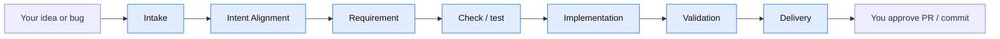
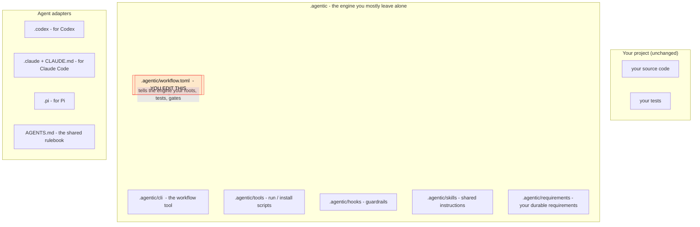
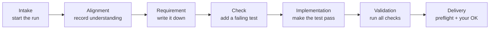

<!--
Copyright (c) 2026 DDP Engineering
This software is licensed under the PolyForm Noncommercial License 1.0.0.
Commercial use requires a separate commercial license.
See the LICENSE.txt in the .agentic folder for full license details. SPDX-License-Identifier: LicenseRef-PolyForm-Noncommercial-1.0.0
-->

# How To Start And Adapt A New Project

A plain-language guide to using the agentic workflow template in your own
project. No prior knowledge of the template internals is needed.

If you only remember one thing: **copy the template into your repo, then edit one
file — `.agentic/workflow.toml` — to match your project.** Everything else is
optional polish.

---

## 1. What is this, in one paragraph?

This template gives an AI coding agent (Codex, Claude Code, or Pi) a disciplined way
to work on your project. Instead of letting the agent change code freely, the
work is broken into seven **gates**. At each gate the agent stops, shows you
what it did, and waits for your approval. Intent Alignment is the independent
gate after intake where the agent records what it understood, how that relates
to the current software, open questions with default responses, risk, and the
planned path. Every behavior change must still be tied to a written requirement
and a test, so later work cannot quietly undo earlier work. You stay in control
the whole time.



You drive it with normal chat prompts. The template adds a small command-line
tool, some guardrail "hooks", and instructions the agent reads automatically.

---

## 2. What you need before you start

| You need | Why | How to check |
|---|---|---|
| **Python 3.11+** on your PATH | Runs the workflow tool and the guardrail hooks | `python --version` |
| **Git** | The tool uses git to scan changes, find secrets, and gate delivery | `git --version` |
| An AI agent | Codex, Claude Code, **or** Pi (the template supports all three) | — |

> Without git, the delivery check fails on purpose and you cannot finish a run.
> Always work inside a git repository.

---

## 3. The big picture: what gets added to your repo

When you copy the template in, your project gains these folders/files. You rarely
touch most of them.



The **only file you must edit** is highlighted: `.agentic/workflow.toml`.

---

## 4. Step-by-step

### Step 1 — Copy the template into your project

From this template repository, run the helper (replace the path with your new
project folder):

```powershell
python 02_Tools\create_project_from_template.py D:\Path\To\NewProject
```

Or simply copy everything inside `04_Software/agentic-workflow-template/template/`
into your project's root folder by hand. After this, your project root contains
`.agentic/`, `.codex/`, `.claude/`, `.pi/`, `AGENTS.md`, `CLAUDE.md`, and a few
docs.

### Step 2 — Make sure it is a git repository

```powershell
cd D:\Path\To\NewProject
git init        # skip if your project is already a git repo
```

### Step 3 — Check the tool runs

```powershell
.\.agentic\tools\run.ps1 --help
```

On Linux/macOS use `bash .agentic/tools/run.sh --help` instead. If you see the
list of commands, you are ready. (Optional: run `.\.agentic\tools\install.ps1`
to install a faster `agentic-workflow` command — not required.)

### Step 4 — Adapt `.agentic/workflow.toml` (the important step)

This file tells the engine where your code, tests, and docs live, and what
commands to run. Open it and adjust it to your project.

The defaults assume source in `src/`, tests in `tests/`, and Python. Here is a
**worked example** for a project called *invoicer* whose code lives in
`invoicer/` and whose tests live in `tests/`:

```toml
[source]
roots = ["invoicer"]          # was ["src", "app", "lib"]

[tests]
roots = ["tests"]

[traceability]
language = "python"
source_extensions = [".py"]
coverable_roots = ["invoicer"] # keep this the same as [source] roots

[gates]
# These start EMPTY. Put your real commands here, or "gates run" does nothing.
test = ["python -m pytest -q"]
lint = ["python -m ruff check ."]

[write_zones]
# IMPORTANT: keep these aligned with the roots above (see the gotcha below).
implementation = ["invoicer/**", ".agentic/knowledge/components/**"]
check = ["tests/**"]
```

Things you will commonly change:

| Setting | What it means | Example |
|---|---|---|
| `[source] roots` | Where your code lives | `["invoicer"]` |
| `[tests] roots` | Where your tests live | `["tests"]` |
| `[gates] test` / `lint` | Real commands to validate the project (default empty) | `["python -m pytest -q"]` |
| `[traceability] language` | How linked tests are matched: `python`, `java`, `c`, `cpp`, or other | `"python"` |
| `coverable_roots` | Which code files must be tied to a requirement | `["invoicer"]` |
| `[secrets] patterns` | Token shapes that must never be committed | keep the defaults |
| `[write_zones]` | Which files the agent may edit at each gate | see gotcha |

### ⚠️ The one gotcha: keep `write_zones` aligned with your roots

A guardrail stops the agent from editing the "wrong" files at each gate. During
the **implementation** gate it may only touch the paths listed in
`write_zones.implementation`. If your code is in `invoicer/` but that list still
says `src/**`, the agent will be **blocked from editing its own code** and you
will see confusing "edit outside write zone" messages.

> Rule of thumb: whenever you change `[source] roots`, change
> `write_zones.implementation` to match. Whenever you change `[tests] roots`,
> change `write_zones.check` to match.

### Step 5 — (Optional) glance at the agent adapters

You usually do **not** need to edit these:

- **Claude Code** — `.claude/settings.json` already wires the guardrails and
  blocks pushing/PRs by default. Leave it unless you want different rules.
- **Codex** — `.codex/config.toml` runs offline by default
  (`network.enabled = false`). Leave it offline unless your project genuinely
  needs network access and you approve it.
- **Pi** — `.pi/` ships a bridge extension that wires the same guardrails. Run
  `pi install ./.pi` and trust the project on first start. The skills surface as
  `/skill:<name>`. See `.pi/README.md`. Python must be on your PATH.
- `AGENTS.md`, `CLAUDE.md`, and the skills are the shared rulebook — **leave
  them as-is.**

### Step 6 — Let the agent sanity-check your setup

Open your new project in Codex, Claude Code, or Pi and paste this prompt. It does not
change anything — it just verifies your `workflow.toml` matches the real project:

```text
Use the agentic development workflow installed in this repository.
Read AGENTS.md and .agentic/workflow.toml.
Inspect the configured source, test, requirement, and documentation roots.
Tell me whether the configuration matches this project and list any paths or
gate commands that need adjustment. Do not edit files yet.
```

Fix anything it flags, and you are set up.

---

## 5. Using it day to day

Once configured, you just talk to the agent. A typical first task:

```text
Use the agentic development workflow.
Implement feature: add a 10% discount for orders over 100 EUR.
Stop at each gate and wait for my approval.
```

The agent then walks the seven gates, stopping after each one:



What each gate means in plain terms:

1. **Intake** - the agent starts the run and identifies the likely request type.
2. **Intent Alignment** - it records understanding, scope, assumptions, open
   questions with recommended default responses, risk, decision, reason, and
   planned paths. This gate can be skipped with `[alignment].enabled = false`.
3. **Requirement** - it writes the requirement down (in
   `.agentic/requirements/`). You approve the wording.
4. **Check** - it adds a test that *fails first* (proving the test is real).
5. **Implementation** - it writes code until that test passes, and only touches
   allowed files.
6. **Validation** - it runs your gate commands, audits, and reviews the change.
7. **Delivery** - it runs a final preflight and asks before committing/pushing.

You can stop, revise, or abort at any gate. Nothing is pushed or committed
without your explicit go-ahead.

`PROMPT_CHEATSHEET.md` (copied into your project) has ready-to-use prompts for
every gate.

---

## 6. Quick checklist

```text
[ ] Copy template/ into the new project root
[ ] git init (if needed)
[ ] Python 3.11+ and git available
[ ] run.ps1 --help works
[ ] Edit .agentic/workflow.toml:
      [ ] [source] roots        -> your code folders
      [ ] [tests] roots         -> your test folders
      [ ] coverable_roots       -> same as [source] roots
      [ ] [gates] test / lint   -> your real commands
      [ ] [traceability] language + source_extensions -> your language
      [ ] write_zones.implementation -> matches [source] roots  (+ .agentic/knowledge/components/**)
      [ ] write_zones.check          -> matches [tests] roots
[ ] (Optional) review .codex/config.toml, .claude/settings.json, and .pi/README.md
[ ] (Pi only) pi install ./.pi and trust the project
[ ] Run the "sanity-check" prompt with your agent
[ ] Start your first feature
```

---

## 7. Adapting to a different layout or language

The example above is Python. For other setups:

- **Different folders** — only the names change. A Java project with code in
  `src/main/java` and tests in `src/test/java` sets those as `[source] roots`
  and `[tests] roots`, and mirrors them in `write_zones`.
- **Different language** — set `[traceability] language` to `java`, `c`, or
  `cpp` for smarter test matching. Anything else falls back to a simple
  name-match, which still works. Set `source_extensions` (e.g. `[".ts"]`) and
  `test_file_patterns` to fit.
- **Docs elsewhere** — if you keep component docs somewhere other than
  `.agentic/knowledge/components/`, update `[documentation] roots`,
  `component_template`, and the `.agentic/knowledge/components/**` entry in
  `write_zones.implementation`.

---

## 8. Troubleshooting

| Symptom | Likely cause | Fix |
|---|---|---|
| "Edit outside write zone" when the agent tries to edit your code | `write_zones.implementation` does not include your source folder | Align it with `[source] roots` |
| `gates run` does nothing | `[gates] test` / `lint` are still empty | Add your real commands |
| Delivery preflight always fails | Not inside a git repo, or git not installed | `git init`; install git |
| Hooks do nothing / not enforced | `python` not on PATH for the agent | Install Python 3.11+, or fix PATH |
| Coverage audit complains about a file | A new code file has no linked requirement | Add a requirement row, or waive legacy files in `.agentic/requirements/coverage_waivers.txt` |

---

## 9. Where to read more

- `AGENTS.md` — the authoritative rulebook the agent follows.
- `CLI_API_REFERENCE.md` — every workflow command, with examples (includes the
  runtime requirements).
- `PROMPT_CHEATSHEET.md` — copy-paste prompts for each gate.
- `Agentic_Development_Architecture/Agentic_Development_Stack_Architecture.md` —
  the deeper design, if you want the full picture.
