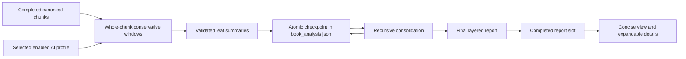

<!-- Copyright (c) 2026 DDP Engineering. SPDX-License-Identifier: LicenseRef-PolyForm-Noncommercial-1.0.0 -->
# Book Analysis

## Purpose

Book Analysis is an optional supporting operation shown immediately after Text
Chunking. It reads only a completed, valid `chunks_text.json` and produces a
short reader-facing summary plus expandable literary and audiobook details in
the project's selected translation target language. It does not advance a
workflow stage, block Translation, or supply canonical character/voice data.

## Runtime Design

`book_analysis_service` packs chunks in sequence and never splits a canonical
chunk. Every accepted provider response is semantically validated before an
atomic checkpoint replaces the previous document. Consolidation repeats in
ordered levels until one summary can drive the final report. A provider-confirmed
context overflow reduces the source budget once to 75 percent and repacks from
the first unprocessed item. An individual chunk that still cannot fit is
rejected with guidance to use Text Chunking or a wider-context profile.

The request budget requires at least 16,384 configured context tokens. Source
text uses at most 50 percent of local LM Studio/Ollama context or 30 percent of
an online OpenAI-compatible context, and is further reduced by prompt, output,
reasoning, and safety reserves. Model names are never allowlisted. The profile's
reasoning preference is provider default, enabled, or disabled; a compatible
provider may reject that control, in which case the shared provider retries
without it.

## Durable Contract And Resume

`book_analysis.json` has two independent slots: `completed_report` and
`candidate_run`. A completed report remains visible while a new candidate is
incomplete or failed. Resume requires the exact canonical source descriptor,
target language, profile ID, and credential-free request-configuration
fingerprint. Selecting a different profile starts a new candidate while
preserving the completed report. A completed report becomes stale only when
the chunks or target language change; current profile selection does not make
it stale.

Persisted running work is presented as interrupted after restart. Analyze
continues an exact candidate; Reset removes only Book Analysis's document and
AI logs. If Reset is pressed while the worker is active, the controller requests
cooperative cancellation and deletes only after the worker reaches a terminal
callback, preventing a late checkpoint from recreating the document.

## UI Contract

The page contains one AI-profile selector and exactly two action buttons:
Analyze and Reset. Context size and reasoning preference remain on AI Settings.
Analyze is disabled while running and after a fresh completion; Reset is enabled
after any work starts. A stale completed report stays visible and enables
Analyze. Operation state appears through the shared left-side Operation Status
control, while active work uses the standard progress dialog/bar.

The concise layer contains book type, genres, subjects, setting/time, short
summary, main characters, and themes. The initially collapsed details layer
contains the detailed summary, supporting characters/relationships, narrative
perspective and structure, tone, pacing, diction, emotional range, audiobook
guidance, uncertainties, and source evidence. Model strings are rendered as
plain text.

## Validation

Automated coverage uses scripted in-process provider results and an autouse
transport guard for every `test_book_analysis*` module. It reads no API keys,
opens no network connection, and starts no LM Studio, Ollama, or online model.
Live application/model acceptance belongs to the operator.

Primary coverage:

- `tests/test_book_analysis_budget_service.py`
- `tests/test_book_analysis_document_service.py`
- `tests/test_book_analysis_service.py`
- `tests/test_book_analysis_state_service.py`
- `tests/test_book_analysis_page.py`
- `tests/test_book_analysis_ui_controller.py`

## Files

- `05_Software/AudioMancer/src/audiomancer/services/book_analysis_budget_service.py`
- `05_Software/AudioMancer/src/audiomancer/services/book_analysis_document_service.py`
- `05_Software/AudioMancer/src/audiomancer/services/book_analysis_service.py`
- `05_Software/AudioMancer/src/audiomancer/services/book_analysis_state_service.py`
- `05_Software/AudioMancer/src/audiomancer/ui/pages/book_analysis_page.py`
- `05_Software/AudioMancer/src/audiomancer/ui/controllers/book_analysis_ui_controller.py`
- `05_Software/AudioMancer/prompts/book_analysis_leaf.txt`
- `05_Software/AudioMancer/prompts/book_analysis_consolidate.txt`
- `05_Software/AudioMancer/prompts/book_analysis_report.txt`
