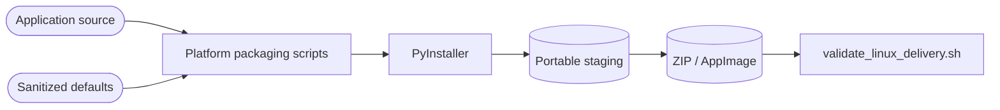

<!--
Copyright (c) 2026 DDP Engineering
This software is licensed under the PolyForm Noncommercial License 1.0.0.
Commercial use requires a separate commercial license.
See the LICENSE.txt in the .agentic folder for full license details.
SPDX-License-Identifier: LicenseRef-PolyForm-Noncommercial-1.0.0
-->

# Release Packaging

## Routing

For frozen runtime imports, portable archives or platform smoke checks, start at
`02_Tools/audiomancer_windows.spec`, `02_Tools/package_linux_release.sh` and the
existing delivery validator. Application credential lifecycle belongs to AI Runtime.

## Purpose and boundaries

Release packaging produces the stable Windows ZIP, Linux ZIP, and Linux
AppImage delivery artifacts from the application source and sanitized default
settings. It validates package structure and runtime dependencies, but does not
publish artifacts or change the release version.

## Public interface

Run `02_Tools/package_windows_release.ps1` on Windows for the portable Windows
ZIP. Under WSL, run `02_Tools/package_linux_release.sh`, followed by
`02_Tools/validate_linux_delivery.sh`, for the Linux ZIP and AppImage. Outputs
use the stable names recorded in `07_Delivery/SHA256SUMS.txt`.

## Invariants

Packaging reads source/default resources and stages sanitized settings. Account credentials
live outside the source and portable roots and are never collected as data files.
Version assignment and publication remain explicit release operations.

## Change map

| Change requested | Start with | Focused verification |
| --- | --- | --- |
| Frozen subscription dependencies | Windows spec / Linux hidden imports | PyInstaller build and offscreen startup |
| Delivery assets and sanitation | Platform packaging scripts | Existing delivery validator |

## Key behaviors

- `REQ-PLAT-03c3187a` - Packages contain version-matched release notes and sanitized settings with no API keys or runtime discovery cache.
- `REQ-PLAT-03c3187a` - Linux validation checks archive contents, AppImage shared libraries, offscreen startup, and SHA-256 checksums.
- `REQ-PLAT-03c3187a` - The Linux build omits PySide6's optional TIFF image plugin because its retired `libtiff.so.5` ABI is unavailable on the supported Ubuntu 24.04 packaging host and AudioMancer does not use TIFF assets.
- `REQ-PLAT-e9388a76` - The active release section in `CHANGELOG.md` is the release note source embedded in both portable archives.
- `REQ-PLAT-c9c8f2b1` - The Windows packager removes Codex host-runtime
  directories from `PATH` while PyInstaller collects binaries, preventing
  foreign Poppler ICU DLLs from shadowing the bundled Qt runtime.

- `REQ-SEC-5317d6ae` - Windows includes httpx/httpcore/certifi; Linux explicitly includes native Secret Service and KWallet backends and keyring metadata. DPAPI is supplied by Windows.

## Architecture

## Files

- `02_Tools/package_windows_release.ps1` - builds the portable Windows ZIP.
- `02_Tools/package_linux_release.sh` - builds the Linux portable bundle, ZIP, and AppImage.
- `02_Tools/validate_linux_delivery.sh` - validates Linux artifacts and refreshes their checksums.
- `07_Delivery/AudioMancer_Windows_x64.zip` - stable Windows delivery archive.
- `07_Delivery/AudioMancer_Linux_x64.zip` - stable Linux delivery archive.
- `07_Delivery/AudioMancer_Linux_x64.AppImage` - stable Linux AppImage.
- `07_Delivery/SHA256SUMS.txt` - release artifact integrity hashes.
- `CHANGELOG.md` - release notes embedded into delivery archives.

- `02_Tools/audiomancer_windows.spec` - frozen Windows dependency analysis.
- `05_Software/AudioMancer/pyproject.toml` and `uv.lock` - runtime dependency declarations and resolution.
