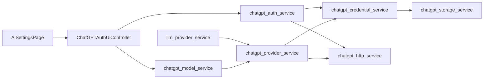

<!--
Copyright (c) 2026 DDP Engineering
This software is licensed under the PolyForm Noncommercial License 1.0.0.
Commercial use requires a separate commercial license.
See the LICENSE.txt in the .agentic folder for full license details.
SPDX-License-Identifier: LicenseRef-PolyForm-Noncommercial-1.0.0
-->

# TASK-e6a5524a - Implement ChatGPT subscription LLM backend

stage: done
type: feature
path: full
interaction: autopilot
requirements: REQ-FUNC-dbf2ccce, REQ-FUNC-92819b45, REQ-FUNC-cfd856fa, REQ-UX-1757fa3f, REQ-UX-3e905eaa, REQ-FUNC-9e98dcb8, REQ-FUNC-bb149fc8, REQ-FUNC-c27e4b20, REQ-FUNC-92d7fe25, REQ-SEC-5317d6ae, REQ-REL-90e02839, REQ-FUNC-be219dba, REQ-FUNC-85b20482, REQ-UX-3d0aeaec, REQ-FUNC-cdc31a8f, REQ-FUNC-0cbc8cba, REQ-SEC-6bf98d63
parent:
branch: ddp/chatgpt-subscription
base: c3566dd92a2a85a50654ebad2ae5ce3d59c60305
opened: 2026-09-16

## Done checklist (current stage)

- [x] Scope, design, requirements and current implementation reviewed
- [x] Knowledge/spec/help/changelog reconciled
- [x] Focused tests, rendered inspection and static audits complete
- [x] Evolution reviewed after final executable edit
- [x] Strict catalog check and final evidence recorded (targeted-only RULING-005)
- [x] Retain uncommitted candidate for user app testing

## Frame

Problem: STATED: implement the saved ChatGPT subscription integration plan. OBSERVED: AudioMancer's current LLM configuration offers local and OpenAI-compatible API-key backends but has no subscription OAuth lifecycle or Responses transport.
Desired outcome: STATED: on a new branch from master, implement the plan under AEGIS. A user can authenticate a ChatGPT account, select a supported subscription model profile, and run supported existing text workflows while retaining API-key/local behavior.
Actors: STATED/INFERRED: AudioMancer operator, OpenAI authorization/inference services, AudioMancer desktop UI and background workers, maintainers validating Windows/Linux packages.
Primary scenario: User selects ChatGPT subscription in AI Settings -> signs in through the browser/device flow -> AudioMancer protects renewable credentials and verifies a model -> the user selects that profile in a text workflow -> the existing JSON/usage/artifact contract receives a complete validated response.
Examples: Plan-derived example: a subscription-backed Book Analysis request and any permitted JSON repair use the same account/backend and merge token usage. A copied portable installation without its protected credential asks for sign-in and preserves the saved profile.
Counterexamples: A subscription token is never substituted into an arbitrary API-key endpoint. Cleanup never silently drops required schema enforcement. A disconnected account is never restored by a late refresh result. TTS is not included.
In scope: Plan tasks 1-8: compatibility investigation, profile/capability contracts, protected credential storage and refresh, PKCE/browser and device login, Responses/SSE, shared facade and repair dispatch, model verification, asynchronous UI/shutdown, online budgeting/reporting, workflow regressions, both help languages, packaging compatibility and Unreleased changelog. Reconcile affected legacy component documentation during validation.
Out of scope: ChatGPT website scraping/cookie reuse; reading/importing another application's credentials; account rotation; audio/TTS subscription access; tool execution; WebSocket optimization; quota dashboard; release-version assignment; merging/pushing/publication.
Constraints: Preserve chat_json public arguments/result and current API-key/local request behavior; preserve cleanup schema/no-fallback/no-model-repair policy and retry override; keep tokens out of settings/projects/logs/exports/packages; use fixed trusted OAuth/inference destinations; handle cancellation and credential rotation races; follow 01_Documentation/Code_Style.md; record capability evidence honestly. Full lifecycle uses checkpoint mode because interaction.autopilot is absent from .agentic/aegis.toml.
Success signals: Browser/device login, restart/refresh/disconnect, verified model request, settings round-trip, cancellation/shutdown, usage and repair integration, credential-exclusion checks, and existing/new focused/full tests pass. Live entitlement/schema and platform packaging claims have corresponding observed evidence; unavailable strict capabilities are explicit.
Evidence: STATED: user request in this conversation and 00_Planning/ChatGPT_Subscription_Integration_Plan.md. OBSERVED: master/HEAD c3566dd92a2a85a50654ebad2ae5ce3d59c60305; plan was the only untracked file; config.py LLM_BACKEND_OPTIONS and ONLINE_AI_BACKEND_KIND; services/llm_provider_service.py chat_json and repair helper; services/cleanup_ai_adjudication_service.py _ask; .agentic/knowledge/AI_Runtime.md, Platform_Settings_UI.md and Operation_Orchestration.md. Application source paths are under 05_Software/AudioMancer/src/audiomancer/. INFERRED: a separate native adapter behind the facade minimizes changes to existing workflows. UNKNOWN: live protocol/model/schema acceptance and final secure-store packaging choice.
Assumptions: Use the plan's native Python OAuth/Responses design provisionally; keep the App Server alternative explicit if compatibility evidence changes that choice. One account/workspace per OS user may back multiple profiles. No release or publication requested. Keep the existing untracked planning artifact with this delivery candidate. No delegated agents or child tasks are needed at Frame.
Unknowns: Direct-route integration/registration expectations; account/workspace/model entitlement; exact strict-schema support; required optional/residency headers; secure-store realistic token size and packaged availability; bounded stream cancellation. Existing component pages have legacy numbered sections rather than Routing; use their cited seams and reconcile touched pages later. No test account has been connected and no live sign-in/inference has been attempted.
Decision-blocking questions: No additional product information is needed for Frame/specification. The configured Frame checkpoint needs a continue/revise/pause decision. A later live compatibility check requires the user to complete OpenAI sign-in on an account they choose; never request a password or pasted token. Failure to establish direct-route/schema compatibility must be surfaced before claiming full workflow support.
Proposed behaviors: Dedicated chatgpt_subscription backend and non-secret credential reference; protected/session-only account storage; explicit browser/device sign-in and disconnect; synchronized renewable credentials; Responses/SSE transport with complete-terminal-response validation; same-backend repair; honest model/capability status; cancellation-aware background UI; preserved strict cleanup behavior and existing providers. These map to the scenario and success signals above and plan sections 6-9.
Path and reason: Full. New visible behavior, interfaces/data, authentication and storage are substantial and cross several components. Keep one integrated task because auth/transport/profile/UI contracts are tightly coupled.

Quick-path assessment:

| Criterion | Yes | No | Evidence |
| --- | --- | --- | --- |
| No new externally observable behavior | | x | Subscription sign-in and backend selection are new |
| No new interface or data format | | x | OAuth envelope, credential reference and Responses/SSE |
| No new dependency | | x | Secure-store/transport dependency choice remains unknown |
| Existing requirement fully covers behavior | | x | Existing AI Runtime contracts do not specify subscription authentication |
| No security or data-handling change | | x | Renewable account credentials and protected persistence |

## Requirement coverage

| Frame outcome | Atomic behavior | Requirement | Positive case | Boundary or failure | Verification | Design decision |
| --- | --- | --- | --- | --- | --- | --- |
| Subscription integration | Persist subscription profiles alongside existing backends | REQ-FUNC-bb149fc8 | Round-trip old/new settings; invalid reference and injected token fields cannot survive subscription normalization. | Shared protocol spec defines rejection/recovery | Injected fixtures and legacy tests | config.py |
| Subscription integration | Sign in to ChatGPT with browser PKCE | REQ-FUNC-c27e4b20 | Fake authorization/token servers verify state, verifier, denial, timeout, occupied port, cancellation and cleanup. | Shared protocol spec defines rejection/recovery | Injected fixtures and legacy tests | services/chatgpt_auth_service.py |
| Subscription integration | Sign in to ChatGPT with a device code | REQ-FUNC-92d7fe25 | Simulated code/poll/token responses cover successful exchange, pending, slow-down, denial, timeout and cancellation. | Shared protocol spec defines rejection/recovery | Injected fixtures and legacy tests | services/chatgpt_auth_service.py |
| Subscription integration | Protect subscription credentials and invalidate disconnected sessions | REQ-SEC-5317d6ae | Protected-store and memory fixtures exercise persistence, corrupted/unavailable store, logout/login race, and a real Windows protection round trip. | Shared protocol spec defines rejection/recovery | Injected fixtures and legacy tests | services/chatgpt_credential_service.py |
| Subscription integration | Serialize renewable subscription credentials | REQ-REL-90e02839 | Fake clock/store/token endpoint asserts one rotation, durable write failure, invalid refresh, cancellation, and disconnect ordering. | Shared protocol spec defines rejection/recovery | Injected fixtures and legacy tests | services/chatgpt_credential_service.py |
| Subscription integration | Normalize complete subscription Responses streams | REQ-FUNC-be219dba | Fragmented SSE fixtures test UTF-8/CRLF/multiline, terminal while open, incomplete/refusal/malformed/EOF, HTTP error classification, quotas and cancellation. | Shared protocol spec defines rejection/recovery | Injected fixtures and legacy tests | services/chatgpt_provider_service.py |
| Subscription integration | Preserve subscription JSON and repair contracts | REQ-FUNC-85b20482 | Facade tests verify schema-required failure before inference, same-backend repair, rejection of incomplete text, effective reasoning and legacy regressions. | Shared protocol spec defines rejection/recovery | Injected fixtures and legacy tests | services/llm_provider_service.py |
| Subscription integration | Manage subscription accounts without blocking the desktop | REQ-UX-3d0aeaec | Qt tests exercise login/cancel/disconnect/model-test with profile switching, dialog close and application shutdown; check English/Romanian labels. | Shared protocol spec defines rejection/recovery | Injected fixtures and legacy tests | ui/pages/ai_settings_page.py |
| Subscription integration | Verify subscription model capabilities explicitly | REQ-FUNC-cdc31a8f | Mock live-test fixtures exercise signed-out state, successful text/schema checks, unsupported schema, model changes and reconnect invalidation. | Shared protocol spec defines rejection/recovery | Injected fixtures and legacy tests | services/chatgpt_model_service.py |
| Subscription integration | Account for subscription usage and remote text workflows | REQ-FUNC-0cbc8cba | Usage tests distinguish unknown/zero/cached/reasoning totals; budgeting/cleanup tests classify subscription as online while preserving local behavior. | Shared protocol spec defines rejection/recovery | Injected fixtures and legacy tests | services/token_usage_service.py |
| Subscription integration | Exclude subscription secrets from diagnostics and artifacts | REQ-SEC-6bf98d63 | Sentinel OAuth secrets must be absent from profile persistence, logs, GUI errors and artifact/export-visible payloads under HTTP/storage/auth failures. | Shared protocol spec defines rejection/recovery | Injected fixtures and legacy tests | services/chatgpt_http_service.py |

| AI Settings usability | Fixed actions and compact profile/default columns | REQ-UX-3e905eaa | Defaults below scrollable profiles; actions remain reachable | Large fonts and small windows preserve scrolling | Qt geometry and runtime font-change tests; rendered inspection | Page-owned body scroll and font-derived metrics |
| Subscription catalog | Account-scoped primary model discovery with cached fallback | REQ-FUNC-92819b45 | Future IDs appear; profile edits persist | Offline, malformed data and logout races | Catalog and Qt worker fixtures; native metadata inspection | Fixed GET route, protected one-hour cache |
| Subscription effort | Exact per-profile supported reasoning selection | REQ-FUNC-cfd856fa | Low/High/Max survive persistence and reach wire | Unsupported effort fails; backend switching preserves selection | Settings/provider/UI/fingerprint fixtures; Luna Low live probe | Dynamic options plus Provider default |
| AI Settings usability | Settings forms remain scrollable | REQ-UX-1757fa3f | Forms adapt to small windows | AI Settings footer remains outside scrolling | Main-window dialog integration test | Shell hosts AI Settings directly |

## Design

### Compact layout and model-context follow-up

STATED: restore original dimensions, compact left selectors, preserve profile scrolling, remove idle status labels, and apply subscription context defaults on model selection. OBSERVED: master uses 800x600; native catalog distinguishes context_window=272000 from max_context_window. INFERRED: viewport-driven column stacking supports smaller screens while preserving one-line labels and fixed actions. Contract: bounded metadata is cached; old caches refresh; manual context edits survive reload/refresh until another model is selected. Unknown context remains unchanged. Local/custom model selection stays manual and existing explicit Connect probing remains intact. Idle catalog/account details use tooltips; device codes, progress and errors stay visible. Verification remains targeted only under RULING-005.

### Model discovery and effort extension

STATED: implement automatic primary-model discovery and per-model reasoning selection. OBSERVED: native GET https://chatgpt.com/backend-api/codex/models requires client_version; AudioMancer 2.1.0 with its own connection returns seven entries, five with visibility=list, including Terra/Luna. supported_reasoning_levels and default_reasoning_level differ by model. This metadata-only request performed no inference. UNKNOWN: future upstream schema stability; bounded fallback is required.

REQ-FUNC-92819b45: dedicated catalog service fetches bounded JSON from the fixed destination, filters primary text entries, and stores normalized IDs/efforts/defaults with a timestamp inside the connection envelope. TTL is one hour; explicit refresh bypasses it. Login/disconnect clear it; generation checks reject late writes. Account workers refresh after login and on settings-open status, exposing a source label and Refresh models. No automatic inference, model switching or context-window changes.

REQ-FUNC-cfd856fa: subscription-only reasoning_effort persists the exact choice; reasoning_mode remains a compatible budget summary. Existing enabled migrates to medium; disabled to none, visibly unsupported where the model lacks none. UI uses returned efforts plus Provider default; unavailable saved values remain selected with a warning. Provider rejects known unsupported effort before sending book text, never retries with a different effort, and reports effective effort. Book Analysis fingerprints include subscription effort. Bounded identifiers allow new model/effort names. Built-in fallback metadata is labelled candidate data and cannot grant schema capability. Legacy API-key/local behavior stays unchanged.

Tests cover fixed hosts, bounded/invalid data, filtering, TTL, fallback, 401 rotation, cancellation, logout races, migration, exact wire effort, stale UI results, profile preservation and geometry. The Book Analysis component is touched only at its request-fingerprint seam. No app launch, package build or commit.

Coverage and responsibilities: the coverage table and shared spec bind all eleven requirements to the named service seams. REQ-FUNC-bb149fc8 keeps profile migration in settings/config; subscription credential references are fixed, and secret fields are discarded. REQ-FUNC-c27e4b20 and REQ-FUNC-92d7fe25 share a cancellable fixed-host HTTP client and isolated OAuth service. REQ-SEC-5317d6ae and REQ-REL-90e02839 use a protected store, durable generation tombstones, process/thread locking and a credential manager; no refresh state belongs to profiles. REQ-FUNC-be219dba owns Responses parsing and terminal validation. REQ-FUNC-85b20482 dispatches through the existing facade with shared JSON/repair helpers and canonical completion data. REQ-UX-3d0aeaec owns a separate non-modal account worker and stale-result guards. REQ-FUNC-cdc31a8f records model/schema verification in protected connection state. REQ-FUNC-0cbc8cba extends the shared online classification and usage parser. REQ-SEC-6bf98d63 requires safe diagnostic boundaries throughout.

Interfaces and state: synchronous service entry points serve existing worker callers; httpx AsyncClient runs in a worker-owned asyncio loop, cancels and awaits I/O before returning. A normalized completion carries text, canonical usage and effective reasoning. Profile data contains only the backend, canonical informational URL and account reference. Protected state contains version, random generation, credentials and verified model metadata. Login captures generation; disconnect replaces it with a tombstone. Refresh preserves generation but rotates tokens atomically. All account and capability writes compare generations while holding the same lock.

Security/concurrency: DPAPI protects an atomic per-user Windows file outside portable settings; supported native keyring storage is used elsewhere. Explicit memory-only mode is available if desired. No fallback writes plaintext. OAuth callback is state-checked and loopback-only; requests reject redirects and use fixed host constants. Lock acquisition, polling, streams and shutdown observe cancellation. Safe typed failures contain no server body, token, callback query or exception representation.

Compatibility: API-key/local code paths and public chat_json shape remain unchanged. Subscription repair uses the same pinned account/model and usage merger. Cleanup checks protected schema evidence before any inference, preserving no-fallback/no-repair and retry_count_override=0. UI subscription controls are conditional; shared workflow selection remains intact. Profiles retain their identities when an account is disconnected.

Failure/recovery: only bounded pre-output transient retries and one authorization refresh are allowed; terminal incomplete/refusal/tool output never reaches JSON repair. Pending login and refresh cannot overwrite a disconnect. A protected-write failure is visible and never claims persistence. Model candidates are labelled candidates until verified; manual model entry is supported. Live protocol/schema proof remains an explicit validation dependency, separate from synthetic fixtures.

Test seams: injected httpx transports/clocks/stores test OAuth, SSE and lifecycle without credentials. Settings tests cover migration/secrets, facade tests cover strict schema/repair/usage, Qt tests cover profile-switch/close/shutdown. Real Windows DPAPI round-trip and a user-mediated live account check supplement unit tests. Existing connector/workflow tests provide regression coverage.

Alternatives: using the Codex App Server would add a runtime/process dependency and remains a fallback requiring a deliberate design decision. Fake Chat Completions envelopes obscure Responses completion state; use explicit normalized data instead. urllib worker cancellation cannot abort the underlying request; retain it only for legacy providers. Native secure storage avoids adding a portable secret file.

Expected files: the requirement affected_paths, new tests/test_chatgpt_*.py, existing settings/provider/UI/usage tests, dependency lock/manifest, package hooks as needed, both help files, CHANGELOG.md and the three touched component pages. Risks/open evidence: upstream client registration and subscription model/schema acceptance are external and experimental; OS keyring availability must fail closed. No product scope question remains.

### Proposed architecture - TASK-e6a5524a

## Log

- 2026-09-16 frame: User accepted autopilot through validation and prohibited commits; scope accepted and advanced to specify. Existing staged review-policy configuration and project-context changes are preserved.

- 2026-09-16 frame: Full path selected for the authorized subscription plan; created ddp/chatgpt-subscription directly from local master c3566dd9 and retained the planning artifact. Scope card prepared; paused at the configured Frame checkpoint. Source/knowledge inspection confirmed the connector and cleanup boundaries; no product code or live account operations performed.

- 2026-09-16 specify: Created 11 draft atomic requirements and one shared protocol spec; reused existing provider contracts as regression constraints, revised/retired none. Check exit 0, errors=0; draft module paths do not exist yet, two older delivery journals and an unrelated ticket-ref remain advisory.

- 2026-09-16 design: Recorded responsibilities, normalized interfaces, protected-state concurrency, failure recovery and proposed architecture in Design. Native route remains experimental pending live evidence. Proceeding to build under authorized autopilot.

- 2026-09-16 build red: REQ-FUNC-bb149fc8; command=`cd 05_Software/AudioMancer; uv run pytest -q tests/test_chatgpt_settings.py`; exit=1; expected missing behavior=subscription backend reset to lmstudio.

- 2026-09-16 build green: REQ-FUNC-bb149fc8; `cd 05_Software/AudioMancer; uv run pytest -q tests/test_chatgpt_settings.py tests/test_settings_service.py`; exit=0; 56 passed. External commit 2575a75 records existing AEGIS configuration/context edits and is preserved; this agent made no commit.

- 2026-09-16 build red: REQ-SEC-5317d6ae, REQ-REL-90e02839; command=`cd 05_Software/AudioMancer; uv run pytest -q tests/test_chatgpt_credentials.py`; exit=1; all five lifecycle scenarios fail at the explicit missing protected-account service assertion. No import/fixture error.

- 2026-09-16 build green: REQ-SEC-5317d6ae, REQ-REL-90e02839; `cd 05_Software/AudioMancer; uv run pytest -q tests/test_chatgpt_credentials.py`; exit=0; five tests include native Windows DPAPI, restart/tombstone, concurrent single rotation, stale login/capability rejection and safe storage failure.

- 2026-09-16 build red: REQ-FUNC-c27e4b20, REQ-FUNC-92d7fe25, REQ-SEC-6bf98d63; command=`cd 05_Software/AudioMancer; uv run pytest -q tests/test_chatgpt_auth.py`; exit=1; five scenarios fail at the explicit missing OAuth service boundary; fixtures cover PKCE/callback cleanup, device polling, cancelled transport cleanup and safe HTTP errors.

- 2026-09-16 build green: REQ-FUNC-c27e4b20, REQ-FUNC-92d7fe25, REQ-SEC-6bf98d63; `cd 05_Software/AudioMancer; uv run pytest -q tests/test_chatgpt_auth.py tests/test_chatgpt_credentials.py`; exit=0; 10 passed including real loopback wrong-state/success/port cleanup and awaited cancellation.
- 2026-09-16 build red: REQ-FUNC-be219dba; command=`cd 05_Software/AudioMancer; uv run pytest -q tests/test_chatgpt_provider.py`; exit=1; eight scenarios expose missing Responses transport boundary before their stream/capability/retry assertions.

- 2026-09-16 build green: REQ-FUNC-be219dba; `cd 05_Software/AudioMancer; uv run pytest -q tests/test_chatgpt_provider.py`; exit=0; eight stream/retry/schema-boundary tests passed.
- 2026-09-16 build red: REQ-FUNC-85b20482, REQ-FUNC-0cbc8cba; command=`cd 05_Software/AudioMancer; uv run pytest -q tests/test_chatgpt_facade.py`; exit=1; subscription incorrectly dispatches to legacy API-key transport, remote classification is false, and Responses usage is unavailable.

- 2026-09-16 build green: REQ-FUNC-85b20482, REQ-FUNC-0cbc8cba; `cd 05_Software/AudioMancer; uv run pytest -q tests/test_chatgpt_facade.py tests/test_chatgpt_provider.py tests/test_llm_provider_service.py tests/test_token_usage_service.py tests/test_ai_budget_service.py`; exit=0; 93 passed, 3 existing optional cases skipped.
- 2026-09-16 build live: User completed browser OAuth; protected credentials survived a fresh process. gpt-5.4 explicitly rejected as unsupported. gpt-5.5 returned a completed Responses SSE stream with no Content-Type header and empty terminal output; text arrives in output_item.done/deltas. This is protocol compatibility evidence, not malformed content.
- 2026-09-16 build red: REQ-FUNC-be219dba; `cd 05_Software/AudioMancer; uv run pytest -q tests/test_chatgpt_provider.py::test_live_dialect_allows_missing_content_type_and_empty_terminal_output`; exit=1; live-shaped valid completed stream rejected by Content-Type/terminal-output assumptions.

- 2026-09-16 build green/live: Responses compatibility fixture passes (nine provider tests). Fresh-process native gpt-5.5 text request returned {ok:true}, usage 29+9=38; strict Cleanup-shaped probe returned matching batch/question/enum output despite contrary user text, usage 103+91=194. No book content used.
- 2026-09-16 build red: REQ-FUNC-cdc31a8f; command=`cd 05_Software/AudioMancer; uv run pytest -q tests/test_chatgpt_models.py`; exit=1; three cases expose missing protected model-verification service boundary.

- 2026-09-16 build green: REQ-FUNC-cdc31a8f; `cd 05_Software/AudioMancer; uv run pytest -q tests/test_chatgpt_models.py tests/test_ai_backend_service.py`; exit=0; 31 passed, including account-bound schema evidence and preserved API-key discovery.
- 2026-09-16 build red: REQ-UX-3d0aeaec; command=`cd 05_Software/AudioMancer; uv run pytest -q tests/test_chatgpt_ui.py`; exit=1; three UI cases fail on missing account controls before exercising worker/profile/close lifecycles.

- 2026-09-16 build green: REQ-UX-3d0aeaec; 23 settings-page/account-worker tests passed; additional focused main-window, controller and Cleanup contract run passed 106 tests.
- 2026-09-16 build red: REQ-SEC-5317d6ae, REQ-FUNC-92d7fe25, REQ-SEC-6bf98d63; `cd 05_Software/AudioMancer; uv run pytest -q tests/test_chatgpt_credentials.py::test_explicit_session_mode_works_when_native_store_is_unavailable tests/test_chatgpt_auth.py::test_device_explicit_denial_does_not_poll_until_timeout tests/test_chatgpt_auth.py::test_hosted_model_rejection_has_actionable_safe_diagnostic`; exit=1; explicit memory mode blocked by unavailable store, denied device flow incorrectly continued polling, and known model rejection lacked specific recovery.

- 2026-09-16 build red: REQ-FUNC-be219dba; `cd 05_Software/AudioMancer; uv run pytest -q tests/test_chatgpt_provider.py::test_wall_clock_timeout_after_output_never_replays_request`; exit=1; total-deadline timeout retried a partially emitted stream. Conservative deadline failures must remain non-retryable even when the inner transport is cancelled.

- 2026-09-16 build integration: Read App Shell, Text Cleanup and Release Packaging ownership pages alongside the original three components; bounded additions are window account shutdown, hosted Cleanup classification and frozen dependency collection. Migrated all six affected pages to the current knowledge template while preserving existing contracts.
- 2026-09-16 build green/live: Native refresh rotated successfully with the same account; protected model verification succeeded for gpt-5.5 text/schema, and a fresh shared chat_json request returned {ok:true} with 24+31=55 usage. Windows PyInstaller built and remained alive in an isolated offscreen startup. Linux focused tests passed 37 with two Windows-only skips using task-local dependencies.
- 2026-09-16 build green: Total-deadline retry regression fixed; 13 provider tests passed, including awaited stream cancellation and one bounded 401 rotation. Session-only/explicit-denial recovery focused set passed 17 tests; cross-process Windows refresh test confirms one durable rotation.

- 2026-09-16 build verification: Additional browser/device cancellation and timeout, denied callback cleanup, corrupt DPAPI recovery, plaintext-keyring rejection, queued logout and blocked-worker shutdown tests passed (28 tests). Earlier consolidated connector/UI/localization run passed 143 with three existing optional skips.
- 2026-09-16 build red: REQ-FUNC-85b20482; `cd 05_Software/AudioMancer; uv run pytest -q tests/test_chatgpt_provider.py -k explicit_schema`; exit=1; three cases expose missing explicit optional-schema fallback interface. Anchored before implementation. Added bounded call-local fallback only for an explicit unsupported formatting parameter; required schema and zero-retry callers still fail without downgrade.
- 2026-09-16 build green: `cd 05_Software/AudioMancer; uv run pytest -q tests/test_chatgpt_provider.py tests/test_chatgpt_facade.py tests/test_chatgpt_models.py tests/test_chatgpt_auth.py tests/test_chatgpt_credentials.py tests/test_chatgpt_ui.py`; exit=0; 52 passed. No full final suite or strict run has been claimed.
- 2026-09-16 build platform evidence: Linux frozen build completed and offscreen startup reached apply_ui_settings; the bounded launch command subsequently exited 1, so this is startup observation only, not a passing lifecycle test. WSL dependencies followed pyproject ranges rather than the Windows lock. DEVIATION build: Live Linux keyring validation is unavailable in headless WSL; fail-closed storage tests and Linux package startup provide partial evidence, and the desktop keyring check remains outstanding. Temporary Windows rebuild had already completed when the user stopped packaging; no package build process remained. Its source predates the final optional-schema fallback, so it is not a final-candidate package.
- 2026-09-16 build pause: User requested live application testing before any further packaging, then stated the app was already running and prohibited launching another instance. No application launched. Paused autonomous work for the user's live test; all feature changes remain uncommitted. Publication remains prohibited.

- 2026-09-16 specification maintenance: User requested a self-contained protocol spec without temporary planning references. Replaced the delegated scope with explicit profile, OAuth, credential, Responses, JSON/fallback, model, accounting, UI and acceptance contracts in REQ-FUNC-be219dba.md. Documentation only; application launch, packaging, full validation and commits remain paused. Corrected the Handoff status to the supported waiting value.

- 2026-09-16 build scope: User requested compact AI Settings: workflow defaults below a shorter scrollable profile list, fixed visible footer actions, removal of the experimental text block and font-aware alignment. Added REQ-UX-3e905eaa. Design: page owns its scrollable two-column body, shell hosts page directly; footer stays outside scrolling, list height follows row/font metrics. Existing profile/account semantics remain intact.
- 2026-09-16 build red: REQ-UX-3e905eaa; `cd 05_Software/AudioMancer; uv run pytest -q tests/test_ai_settings_layout.py`; exit=1; all six geometry cases expose missing body-only scrolling before checking compact profile/default placement.

- 2026-09-16 build design reconciliation: REQ-UX-1757fa3f now defines scrollable form content with the user-requested fixed AI Settings footer; Settings/TTS wrappers retain their existing behavior. REQ-UX-3e905eaa covers the compact profile/default layout and font changes. Rendered the page offscreen with registered Windows fonts: at 1120x800, both columns and actions fit without body scrollbars; profile overflow remains independently scrollable. No running application instance or user settings were changed.

- 2026-09-16 build focused proof: `cd 05_Software/AudioMancer; uv run pytest -q tests/test_ai_settings_layout.py`; exit=0; eight geometry/integration checks passed, including English/Romanian, 10/16/22 point fonts, 480/780 pixel heights, fixed actions and font growth/shrink. Ruff, changed-file code-style and logging audits pass. Advisory check has zero errors and the same 13 existing catalog/layout warnings; full subscription validation remains pending.

- 2026-09-16 build green: `cd 05_Software/AudioMancer; uv run pytest -q tests/test_ai_settings_layout.py tests/test_ai_settings_page.py tests/test_chatgpt_ui.py tests/test_ai_settings_ui_controller.py tests/test_main_window_ai_profiles.py tests/test_main_window_lifecycle.py tests/test_main_window_operation_shutdown.py tests/test_localization_parity.py tests/test_ui_localization_coverage.py`; exit=0; 72 passed in 401.26 seconds. The subsequently extended layout module separately passed all eight checks. UI feedback implemented and ready for user retest; no launch, packaging or commit performed.

- 2026-09-16 build red: REQ-UX-3e905eaa, REQ-FUNC-cdc31a8f; `cd 05_Software/AudioMancer; uv run pytest -q tests/test_ai_settings_layout.py::test_normal_window_fits_single_line_defaults_and_compact_editor tests/test_chatgpt_models.py::test_smaller_models_are_candidates_without_granting_capabilities`; exit=1; four cases expose the right-heavy layout and missing Terra/Luna candidates. User requests wider single-line defaults and compact actions. Design: label-measured left minimum, narrower single-pair editor rows, text-sized action groups and a larger initial dialog; preserve scrolling for large fonts/small windows and fixed footer.

- 2026-09-16 build green: User-requested Terra/Luna suggestions and layout correction are implemented. Reconciled REQ-FUNC-9e98dcb8 with the authorized narrower editor and flag row. `cd 05_Software/AudioMancer; uv run pytest -q tests/test_ai_settings_layout.py tests/test_ai_settings_page.py tests/test_chatgpt_models.py tests/test_chatgpt_ui.py tests/test_localization_parity.py tests/test_ui_localization_coverage.py tests/test_main_window_lifecycle.py::test_main_window_settings_dialogs_scroll`; exit=0; 46 passed. Rendered local/subscription pages at 980x740, Segoe UI 12pt: left512/right426, body scroll ranges zero, single-line defaults and compact buttons. Ruff, changed code-style/logging audits and diff check pass. Evolution contains ten expected source/test/help/changelog changes; advisory check retains zero errors and 13 existing warnings. No app launch, package build, commit, live model request or user-settings write. Automatic catalog discovery and per-model effort levels were researched in response to the follow-up question; they remain proposals, with the direct subscription catalog route unverified.

- 2026-09-16 build red: REQ-FUNC-92819b45; `cd 05_Software/AudioMancer; uv run pytest -q tests/test_chatgpt_catalog.py`; exit=1; six tests fail at the explicit missing native catalog boundary. User authorized model discovery and effort selection; metadata-only live GET with client_version=2.1.0 confirmed the native schema and five primary models. No inference performed.

- 2026-09-16 build: REQ-FUNC-92819b45 catalog/core fixtures passed 16 tests including existing credential regressions. REQ-FUNC-cfd856fa red: `cd 05_Software/AudioMancer; uv run pytest -q tests/test_chatgpt_settings.py tests/test_chatgpt_provider.py -k "effort or migrates"`; exit=1; three migration cases lose reasoning_effort and three wire cases omit the requested effort. Unsupported-effort guard is also covered.

- 2026-09-16 build: Catalog/settings/provider/facade/model regression set passed 95 tests. REQ-FUNC-92819b45 and REQ-FUNC-cfd856fa UI red: `cd 05_Software/AudioMancer; uv run pytest -q tests/test_chatgpt_ui.py -k "catalog_refresh or manual_refresh"`; exit=1; both cases expose missing catalog application and Refresh models controls.

- 2026-09-16 build: UI/catalog integration passed 42 focused tests. REQ-FUNC-cfd856fa resume red: `cd 05_Software/AudioMancer; uv run pytest -q tests/test_book_analysis_document_service.py::test_subscription_effort_changes_resume_fingerprint_without_changing_local_semantics`; exit=1; changing subscription effort leaves the resume fingerprint unchanged. Book Analysis knowledge read; this compatibility seam is within the recorded extension design.

- 2026-09-16 build red: REQ-FUNC-cfd856fa; `cd 05_Software/AudioMancer; uv run pytest -q tests/test_chatgpt_ui.py::test_backend_round_trip_preserves_explicit_subscription_effort`; exit=1; a temporary local-backend switch silently changes Low to Medium on return. Preserve the last explicit subscription effort across backend edits.

- 2026-09-16 build green: 151 focused connector/UI/Book Analysis/localization tests passed in 330.85s; backend-switch regression then passed with all 38 UI/layout tests. Added an autouse in-memory account/network guard so automatic settings discovery cannot touch real credentials during tests. Required code-style audit necessitated docstring-only cleanup in touched Book Analysis helpers; behavior changes remain confined to the subscription fingerprint.
- 2026-09-16 build inspection: Implemented native catalog returned five primary models (Astra, Sol, Terra, Luna, 5.5), excluding two hidden entries. Synthetic Luna Low request returned {ok:true}, explicit effort low and usage 21 input + 9 output = 30 total; no book content used. Rendered current page offscreen at 980x740 with Segoe UI 12: left512/right426, no body scrollbars, compact Refresh models and fixed footer; Luna offers Low through Maximum, without Ultra.

- 2026-09-16 validate review round 1, specification compliance: approved. Reviewed current scope/requirements/spec against native filtering/cache, exact effort migration/transmission, unsupported-choice retention, fixed footer geometry and credential-free resume fingerprint. Both new requirements activated; help/spec/knowledge/context are current and self-contained. Context auto-configuration remains excluded. No children exist.
- 2026-09-16 validate review round 1, implementation quality: approved. Independently inspected error/retry bounds, current-generation cache locking, cancellation, metadata allowlisting, exact wire effort, profile/backend round trips, legacy dispatch and test isolation. Focused proof and Windows native/live observations support this candidate. Retained earlier Linux native-keyring limitation; no new app launch or package build. Evolution after the latest red anchor contains only the expected editor fix; complete uncommitted diff also reviewed. Ruff, code-style/logging audits and diff check pass. Advisory findings: 0 errors, 14 warnings, 1 note; new secret heuristic matches literal synthetic test authorization values, not credentials; other warnings are existing journals/ticket and authorized files outside configured source/test globs.

- 2026-09-16 validate deviation: Full `check --task TASK-e6a5524a --strict --run` was stopped at the user's explicit request because of runtime; terminated only its verified process tree. It exited 1 due to termination and proves no full-suite result. DEVIATION validate: Full-suite verification stopped at user request; targeted tests and static checks replace it, with live app testing reserved to the user. No full rerun authorized.

- 2026-09-16 validate final: `cd 05_Software/AudioMancer; uv run pytest -q tests/test_chatgpt_catalog.py tests/test_chatgpt_settings.py tests/test_chatgpt_provider.py tests/test_chatgpt_facade.py tests/test_chatgpt_models.py tests/test_chatgpt_auth.py tests/test_chatgpt_credentials.py tests/test_chatgpt_ui.py tests/test_ai_settings_layout.py tests/test_ai_settings_page.py tests/test_book_analysis_document_service.py tests/test_localization_parity.py tests/test_ui_localization_coverage.py` exited 0: 118 passed in 11.05s. Changed-Python Ruff, code-style and logging audits passed; git diff --check passed. `python .agentic/aegis.py check --task TASK-e6a5524a --strict` exited 0 with 0 errors, 14 explained advisory warnings and 1 unrelated manual-verification note. This command did not run the full suite. Independent round-1 verdicts remain approved for the unchanged candidate; RULING-005 supplies the explicit validation exception.
- 2026-09-16 deliver: Model discovery/reasoning implementation is ready for user app testing, with exact request effort and preserved profile/model/backend choices. No commit, app launch or package build performed in this extension. Retain the uncommitted branch; publication is prohibited, not awaiting a new approval question. Accepted limitations: full suite deliberately stopped under RULING-005; earlier Linux native-keyring live check remains unavailable and packages were not rebuilt.

- 2026-09-16 build scope: User requests smaller left default selectors and original dialog dimensions for low/high-resolution monitors, with targeted tests only. OBSERVED master default is 800x600; current 1120x800 and expanding left fields cause excess width. Design: restore screen-bounded 800x600, equal font-derived compact default combos, natural-width profile column, and viewport-driven side-by-side/stacked content when both columns cannot fit. Keep single-line labels, independent list scrolling and fixed footer. No settings semantics change. Reopen build and invalidate prior candidate verdicts; preserve no commit/build/launch and RULING-005.

- 2026-09-16 build red: REQ-UX-3e905eaa; `uv run pytest -q tests/test_ai_settings_layout.py -k "compact_defaults or dialog_hosts"` exited 1 with three expected failures: dialog remains 1120 pixels wide and default combos expand to 498-549 pixels. User additionally requests subscription context auto-defaults on model selection, with subsequent manual edits preserved and local/custom endpoints remaining manual; reconcile discovery metadata and UI contract alongside the layout correction.

- 2026-09-16 build red: REQ-FUNC-dbf2ccce; `uv run pytest -q tests/test_chatgpt_catalog.py tests/test_chatgpt_ui.py -k "context or native_discovery"` exited 1 with seven failures: context metadata is omitted and selecting a subscription model leaves 16384. Native metadata-only inspection reports default context_window=272000 for all five current primary models; max_context_window=872000 for four newer models and 272000 for 5.5. Use the default field, not the larger maximum; preserve unknown values as unknown. Extend normalized cache and refresh legacy entries lacking context metadata. Existing explicit backend probes retain their behavior; automatic model selection remains subscription-only.

- 2026-09-16 build red: REQ-UX-3e905eaa; targeted profile-scroll and catalog-UI tests expose a list jump from scroll value 20 to 18 during payload synchronization and visible idle guidance. User requests removal of idle sign-in/catalog labels and stable selected-profile scrolling. Keep actionable progress/device codes/errors visible; expose catalog source through Refresh models tooltip. Preserve list offset and ensure the selected item remains visible after a rebuild.

- 2026-09-16 build green: Follow-up geometry, catalog-context and list/status changes passed `uv run pytest -q tests/test_ai_settings_layout.py tests/test_ai_settings_page.py tests/test_chatgpt_ui.py tests/test_chatgpt_catalog.py tests/test_chatgpt_settings.py tests/test_chatgpt_models.py tests/test_chatgpt_provider.py tests/test_ai_settings_ui_controller.py tests/test_localization_parity.py tests/test_ui_localization_coverage.py`: exit 0, 95 passed in 9.72s. Targeted coverage includes English/Romanian, narrow/large windows, runtime font changes, stable selected-profile scrolling, hidden idle guidance with visible errors, native default-context cache migration and manual overrides. Offscreen render at 800x600 with registered Segoe UI 12 reports left386/right380, 136-pixel default selectors and zero horizontal/vertical body scroll ranges; all fields and fixed footer are visible. No live app launch, package build or full-suite run.
- 2026-09-16 validate review round 2, specification compliance: approved. Latest user scope supersedes the wider-left/1120x800 layout and manual-only subscription context contract. REQ-UX-3e905eaa and REQ-FUNC-dbf2ccce, self-contained spec, both guides and component knowledge describe the implemented compact/responsive geometry, model-default context, override preservation and idle-status removal. Exact native default is used rather than maximum capacity; unsupported/unknown defaults never invent a limit. Explicit Connect probing remains an existing action, while local/custom model selection stays manual.
- 2026-09-16 validate review round 2, implementation quality: approved. Reviewed cache normalization/legacy refresh, signal blocking and profile ownership, model selection versus catalog refresh, positive context bounds including values over one million, viewport layout transitions, selected-item restoration, and account progress/error visibility. Focused tests and rendered inspection support the current candidate. Ruff, code-style/logging audits and diff check passed. Evolution's eight paths are expected since the latest anchor; earlier layout/main-window/catalog-test edits are retained with their preceding evolution evidence. Verification is targeted only under repeated user instruction and RULING-005; earlier Linux native-keyring limitation is unchanged.

- 2026-09-16 deliver follow-up: Strict catalog check exited 0 with 0 errors, 14 previously explained warnings and 1 unrelated manual-verification note. No executable or verification changes after the 95-test passing targeted run. Review round 2 remains approved. Delivered compact settings/context/scrolling corrections as uncommitted changes for user testing; no full suite, package build, app launch or commit. DEVIATION validate: targeted-only proof replaces full verification at explicit user request; no full-suite result is claimed.

- 2026-09-16 documentation follow-up: User requested the model/reasoning recommendation table in both help files. Returned to validate for prose-only maintenance and added matching 11-step English/Romanian tables under AI Settings, with chapter-comparison guidance, strict Cleanup schema prerequisite, escalation advice, TTS boundaries and the official model reference. Updated Unreleased changelog. Scope review approved: recommendations are advisory, not automatic defaults or benchmark claims. Quality review approved: equivalent model/effort guidance in both languages, existing help structure retained. HTML parser inspection confirmed 11 four-column workflow rows per guide and matching recommended models; git diff --check passed. Evolution refreshed; strict catalog check without --run exited 0, with the same 14 known warnings and one unrelated note. Runtime code unchanged, so no runtime tests rerun; RULING-005 remains in force. Returned to deliver with uncommitted documentation; no app launch or package build.

- 2026-09-16 release validation -> build: Offscreen serial suite timed out during cumulative Qt stylesheet work; culprit passed alone. Four-worker offscreen full run completed with 2022 passed, four failed, four skipped: stale documentation assertion, two offscreen-specific Speech Blocks geometry cases (both pass under native Windows), and an AI Settings callback after page destruction. New regression `uv run --project 05_Software/AudioMancer pytest -q 05_Software/AudioMancer/tests/test_ai_settings_layout.py::test_pending_layout_refresh_is_cancelled_when_page_is_destroyed` exited 1 with deleted QListWidget access. Bind deferred callbacks to page QObject lifetime; update stale guide assertions; run final full suite with native Windows Qt.

- 2026-09-16 release validation: QObject-scoped deferred callbacks pass their destruction regression. Updated obsolete documentation assertions to current models/reasoning and restricted unsupported-sampler checks to AI Settings (TTS has legitimate sampler settings). Final native Windows full suite `uv run pytest -q -n 4 --dist loadfile` exited 0: 2027 passed, four skipped, four audioop deprecation warnings in 1463.13s. Ruff passes. All release version surfaces are 2.2.0 with dated changelog and fresh Unreleased section; packaging follows repository release procedure. Review approved for the bounded lifetime fix and documentation test reconciliation.

- 2026-09-16 release delivery: Version 2.2.0 assigned across project, uv.lock, changelog and both help languages. User explicitly authorized full suite and Windows/WSL2 Linux packages. Final native Windows full suite passed 2027 tests with four skips and four audioop deprecation warnings. Windows ZIP, Linux ZIP and Linux AppImage built successfully. WSL2 Ubuntu 24.04 required uv plus missing PulseAudio/XCB libraries and unzip; installed prerequisites and rebuilt Linux successfully. Both ZIP integrity/version/help/settings checks passed; Linux delivery validator passed archive, shared-library and headless-startup checks. SHA-256 entries verified for all three final artifacts. Windows runtime startup was not separately smoke-tested. No commit, push, release publication or project-content modification performed.

- 2026-09-16 deliver -> done: User explicitly requested closure of the AEGIS tasks and will commit the files. Implementation, version 2.2.0 delivery and recorded validation are complete. Changes remain uncommitted; no commit, push or publication performed.

## Rulings

- RULING-001 | date=2026-09-16 | decision=Create a branch from master and implement the saved subscription plan using AEGIS | reason=Explicit implementation request supersedes the earlier research-only restriction | source=user | supersedes=none
- RULING-002 | date=2026-09-16 | decision=Use checkpoint interaction until the user selects another mode | reason=The interaction table is absent; .agentic/AGENTS.md resolves this to checkpoint and requires stage-boundary choices | source=repository | supersedes=none

- RULING-003 | date=2026-09-16 | decision=Autopilot through implementation and validation; do not commit | reason=Explicit user instruction accepts the Frame and overrides stage pauses; no commit, merge or push | source=user | supersedes=RULING-002

- RULING-004 | date=2026-09-16 | decision=Stop package builds and pause for user live testing; do not launch another app instance | reason=User has already started the app and wants to test before packaging | source=user | supersedes=none

- RULING-005 | date=2026-09-16 | decision=Stop the full test suite; run targeted tests only; user will test the app | reason=Explicit user instruction overrides the full-suite validation procedure for this delivery; do not restart a full run | source=user | supersedes=none

- RULING-006 | date=2026-09-16 | decision=User reports app testing looks good; authorize version 2.2.0 release preparation, full test suite and Windows/Linux packaging via WSL2 | reason=Latest explicit request supersedes targeted-only verification and package-build pause; no commit or publication requested | source=user | supersedes=RULING-005

- RULING-007 | date=2026-09-16 | decision=Close this task; user owns the commit | reason=Explicit user closure instruction after completed release preparation and validation | source=user | supersedes=none

## Handoff

current: done
status: completed
next: No agent work pending; user will commit the files.
must_read: .agentic/tasks/TASK-e6a5524a.md
blockers: none for local delivery.

## Stage report

stage: done
result: completed
current: done
changed: Version 2.2.0, changelog/help versions and Windows/Linux delivery packages.
evidence: Full suite 2027 passed, four skipped; ZIP checks, Linux startup/dependency validation and hashes passed.
issues: audioop deprecation warnings; Windows package startup not separately tested.
next: User will commit the files; packages are ready in 07_Delivery.
needs_user: no
spec_compliance: approved
implementation_quality: approved
review_round: 3
