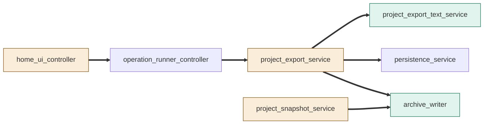
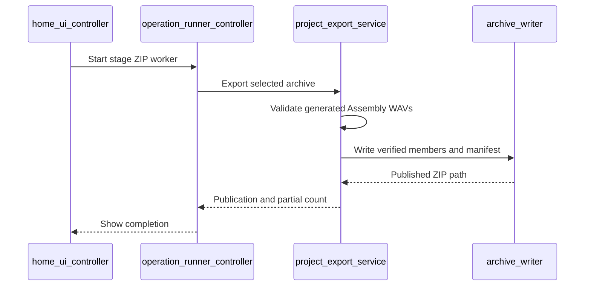
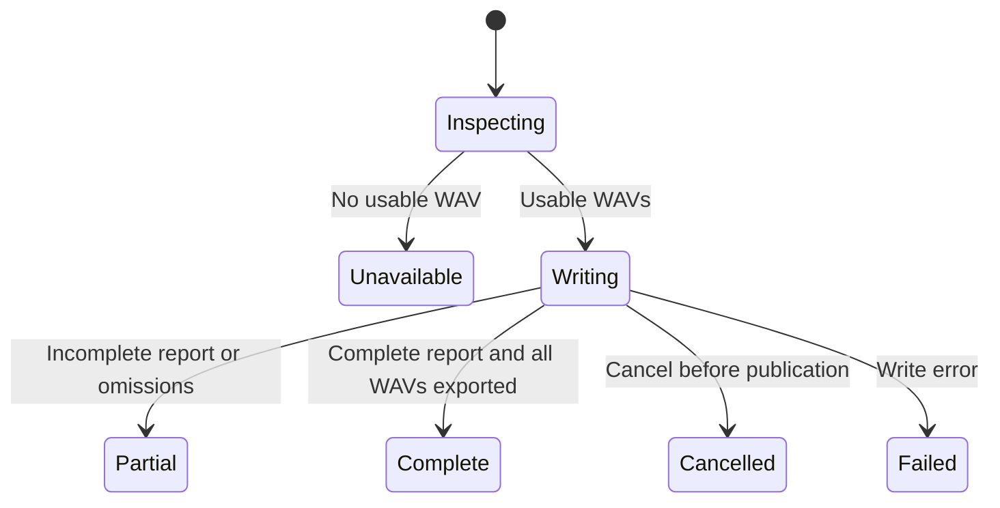

# TASK-05698d38 diagrams

Illustrates the Design in TASK-05698d38.md.

## Structure

Changed: Home, Project Export, Snapshot. Added: text projection and ZIP writer. Reused: runner and text persistence.

## Sequence

## State

