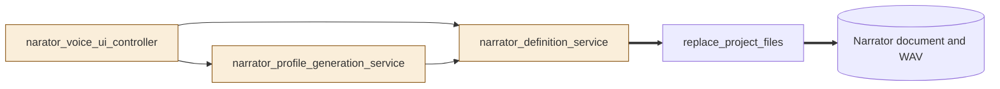
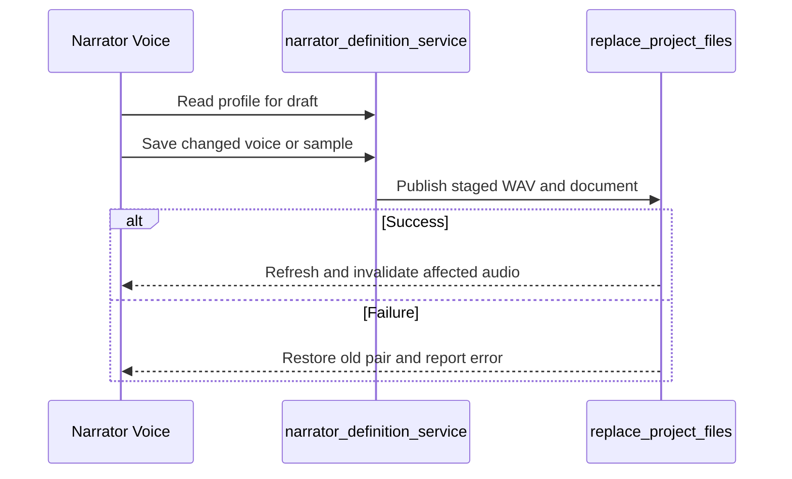
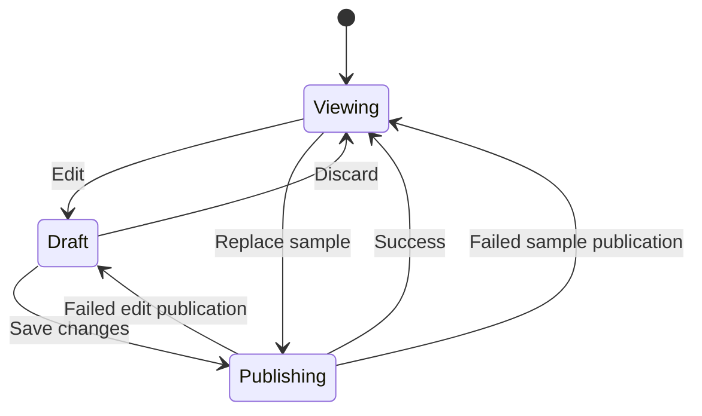

# TASK-08add324 diagrams

The task journal design is authoritative.

## Structure

Changed: narrator controller, definition service, profile generation service.
Reused: project file replacement and narrator voice artifacts.

## Sequence

## State

