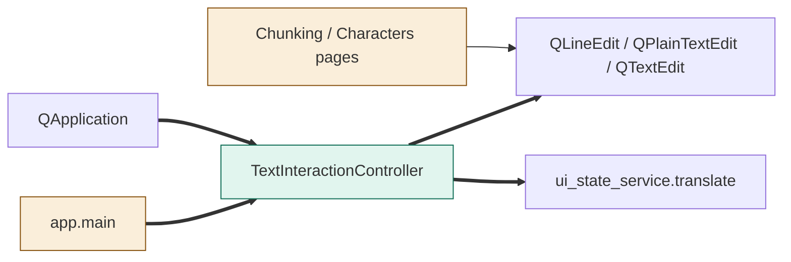
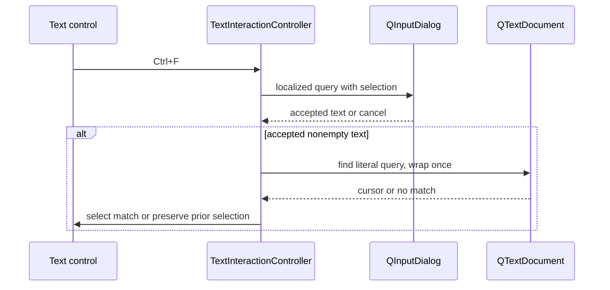
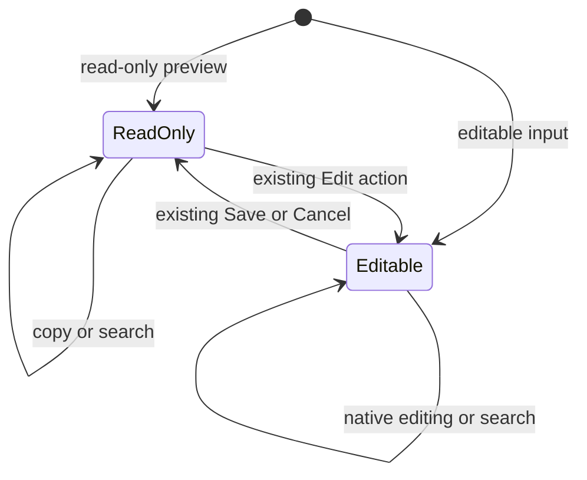

# TASK-0e2636ed diagrams

Illustrates Design in TASK-0e2636ed.md; Design is authoritative.

## Structure

Node map: app.main and page integration changed; TextInteractionController added;
QApplication, native editors and locale catalog reused unchanged as APIs.

## Sequence

## State

These are existing Qt editability states; only their available menu actions change.
