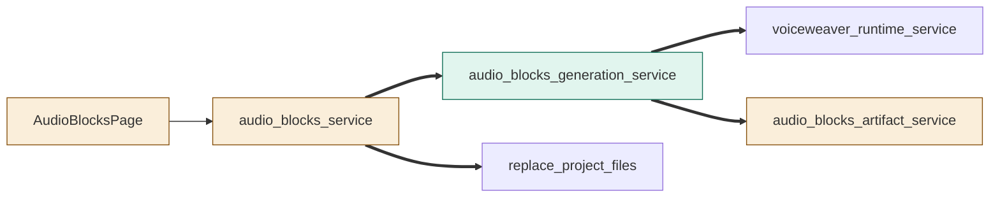
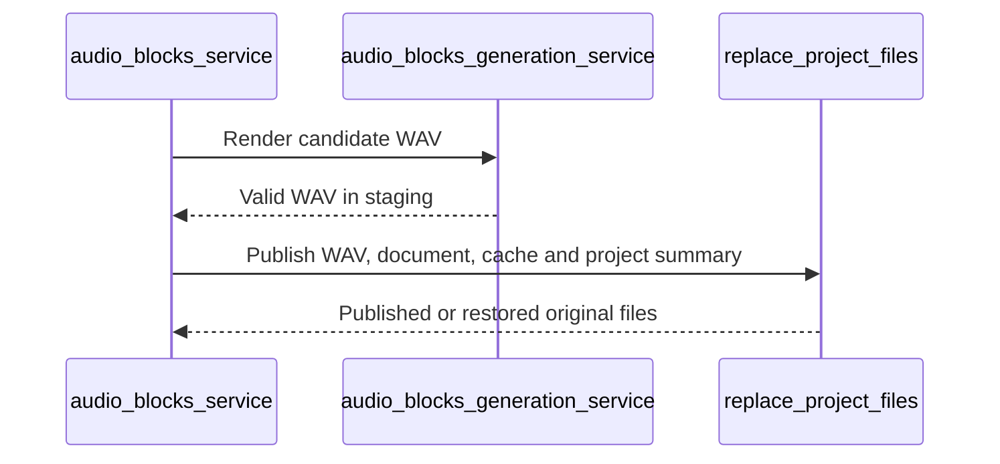
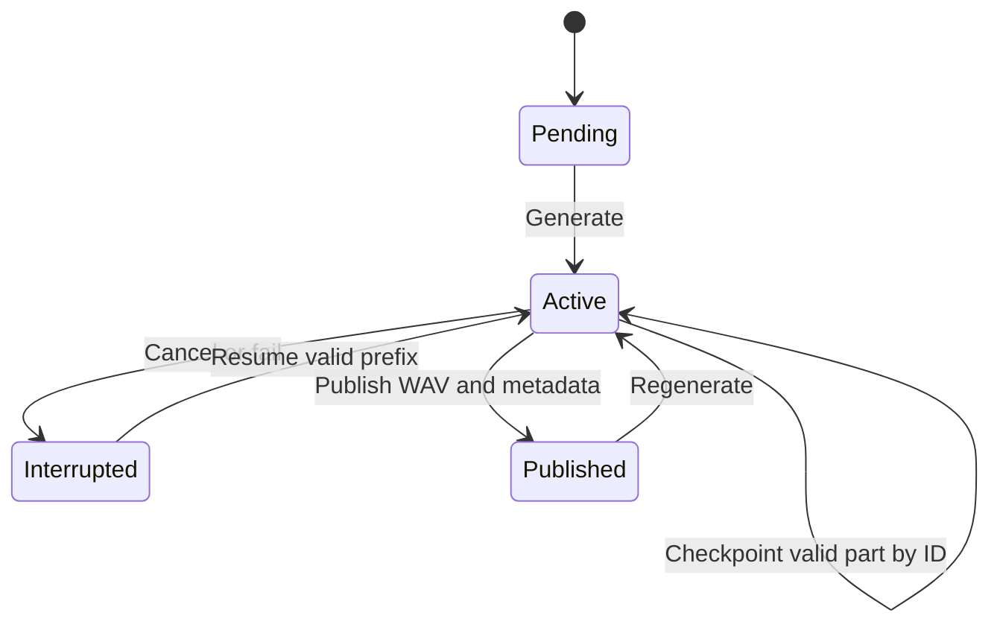

# TASK-55cdb3d4 diagrams

Illustrates Design in TASK-55cdb3d4.md.

## Structure

Changed: audio_blocks_service, audio_blocks_artifact_service, AudioBlocksPage.
Added: audio_blocks_generation_service.
Reused: voiceweaver_runtime_service, replace_project_files.

## Sequence

## State

