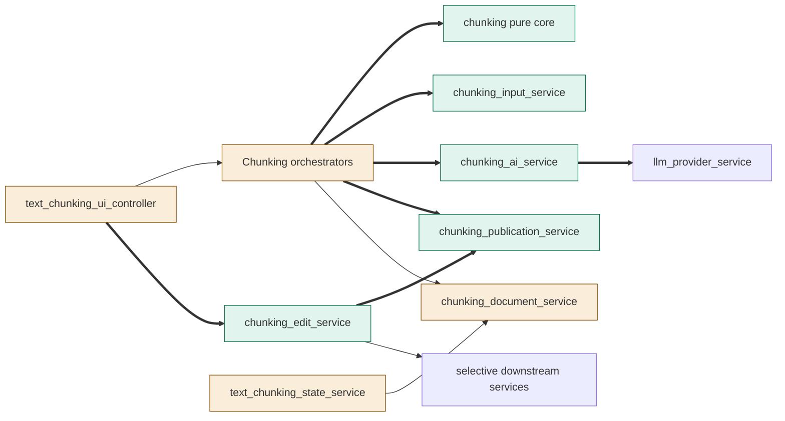
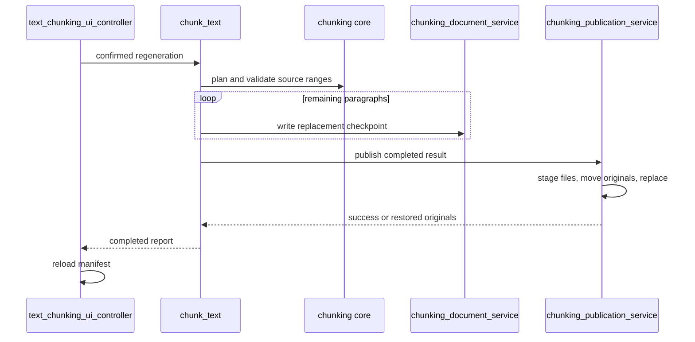
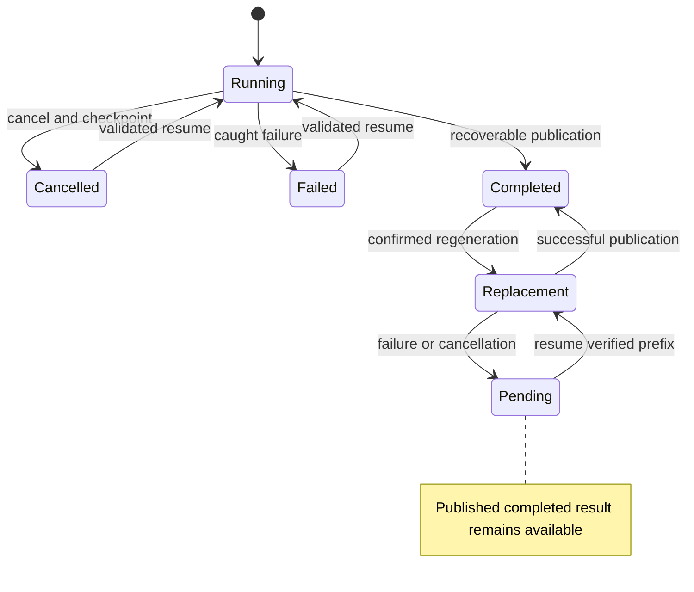

# TASK-5e2c5ab3 diagrams

Illustrates `## Design` in `TASK-5e2c5ab3.md`. The Design text is authoritative.

## Structure

Map: core, input, adapter, edits and publication added; orchestrators, persistence, state and controller changed; provider and downstream services reused.

## Sequence

## State

