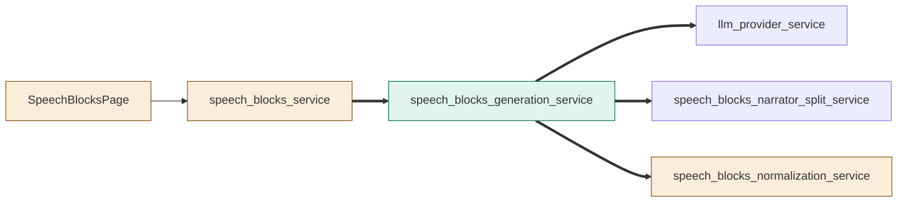
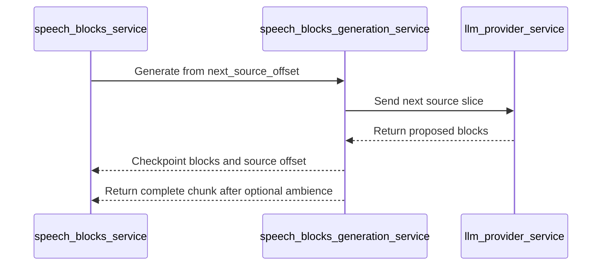
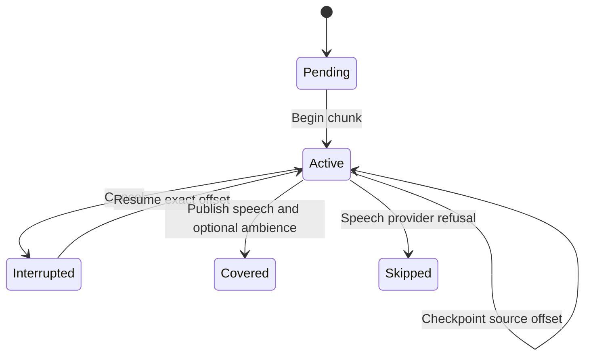

# TASK-622179da diagrams

Illustrates the Design in TASK-622179da.md.

## Structure

Changed: speech_blocks_service, SpeechBlocksPage, speech_blocks_normalization_service.
Added: speech_blocks_generation_service.
Reused: llm_provider_service, speech_blocks_narrator_split_service.

## Sequence

## State

