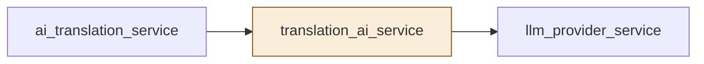
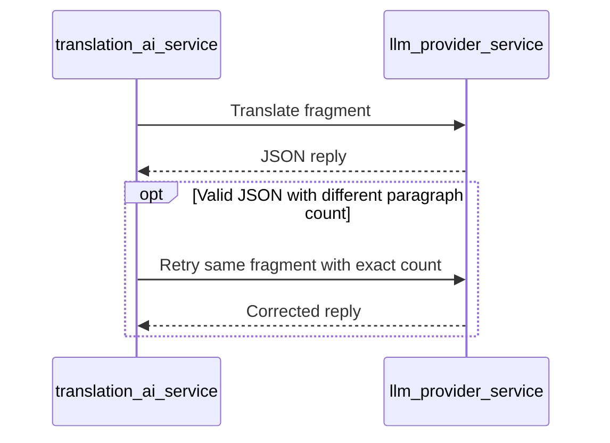
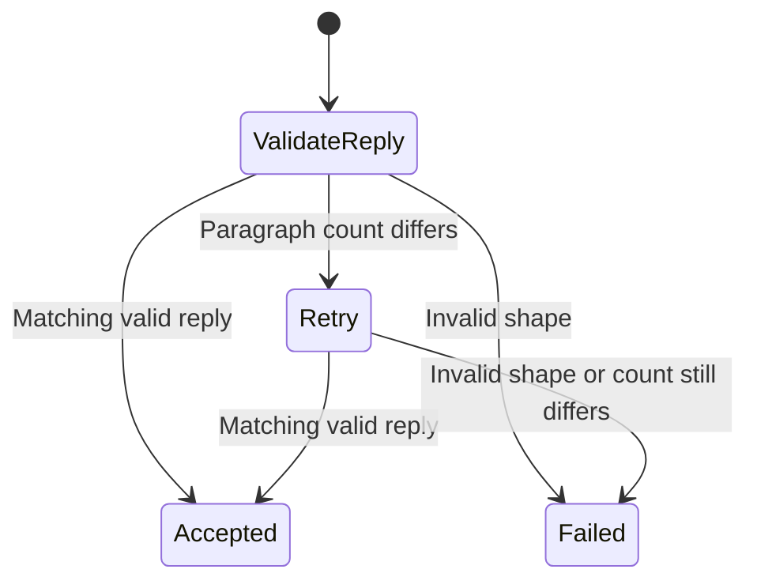

# TASK-6745152f diagrams

The task journal's design is authoritative.

## Structure

Changed: translation_ai_service. Reused: llm_provider_service, ai_translation_service.

## Sequence

## State

