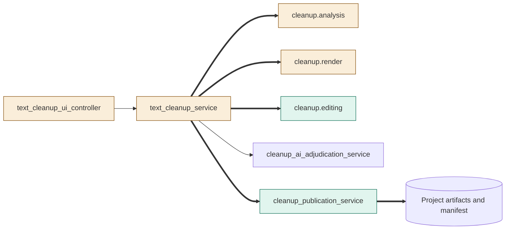
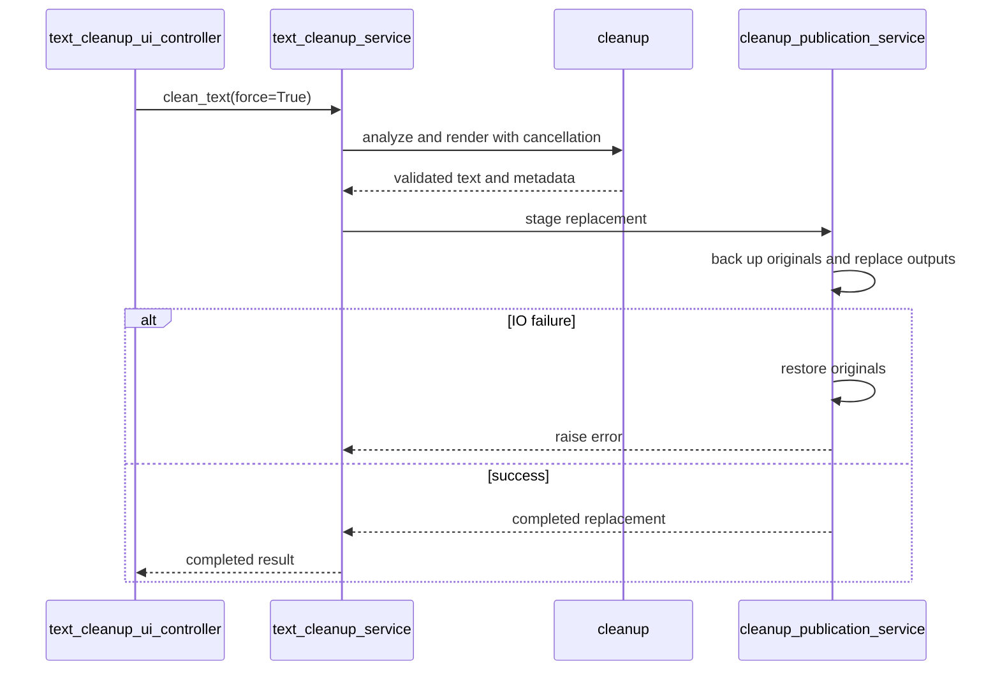

# TASK-75b61845 diagrams

Illustrates Design in TASK-75b61845.md. Design is authoritative.

## Structure

Node map: controller, service, analysis and render changed; publication and editing added; AI and project artifacts reused.

## Sequence

## State

```mermaid
stateDiagram-v2
    [*] --> Running
    Running --> Paused: cancelled during adjudication
    Paused --> Running: resume compatible answers
    Running --> Finalizing: decisions checkpointed
    Finalizing --> Finalizing: cancelled; resume rendering later
    Finalizing --> Completed: validated publication succeeds
    Finalizing --> Finalizing: publication failure; originals restored
    Completed --> Running: confirmed rerun; previous result retained
```

