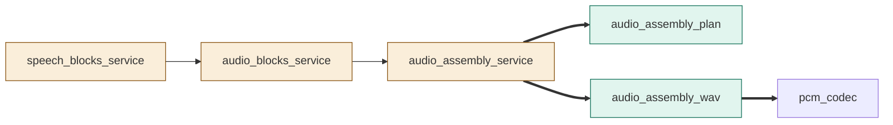
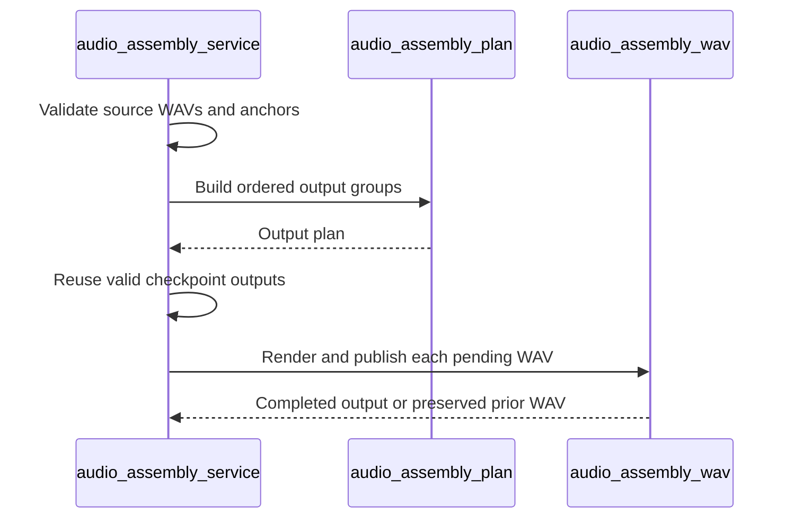
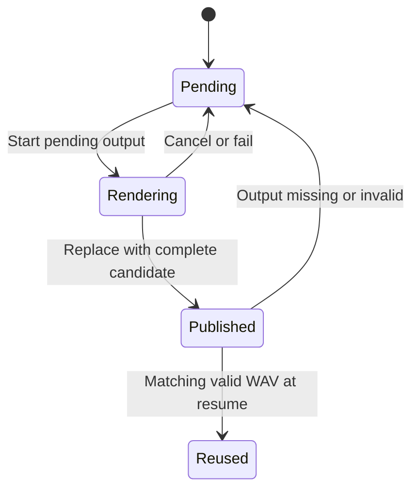

# TASK-8ba293c9 diagrams

Illustrates `## Design` in `TASK-8ba293c9.md`.

## Structure

Changed: audio_blocks_service, audio_assembly_service, speech_blocks_service.
Added: audio_assembly_plan, audio_assembly_wav.
Reused: pcm_codec.

## Sequence

## State

