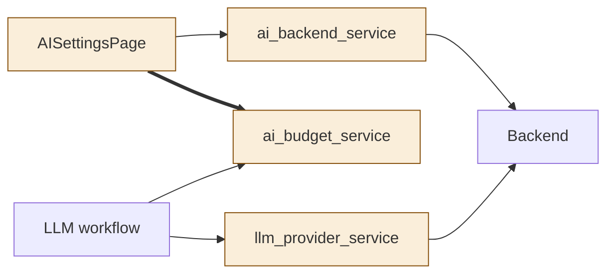
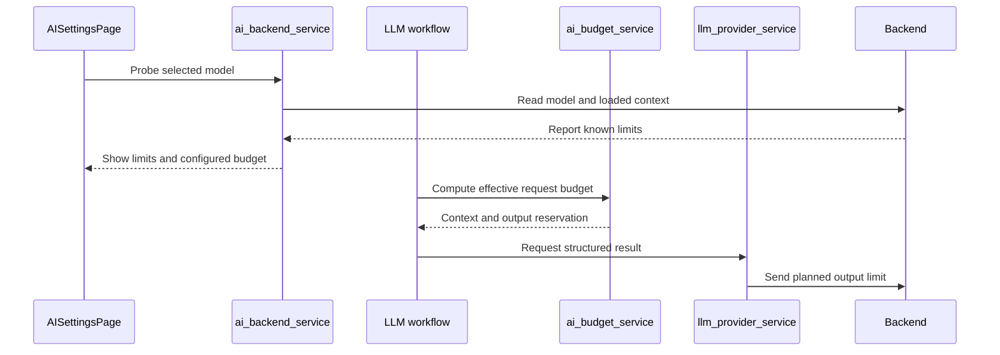
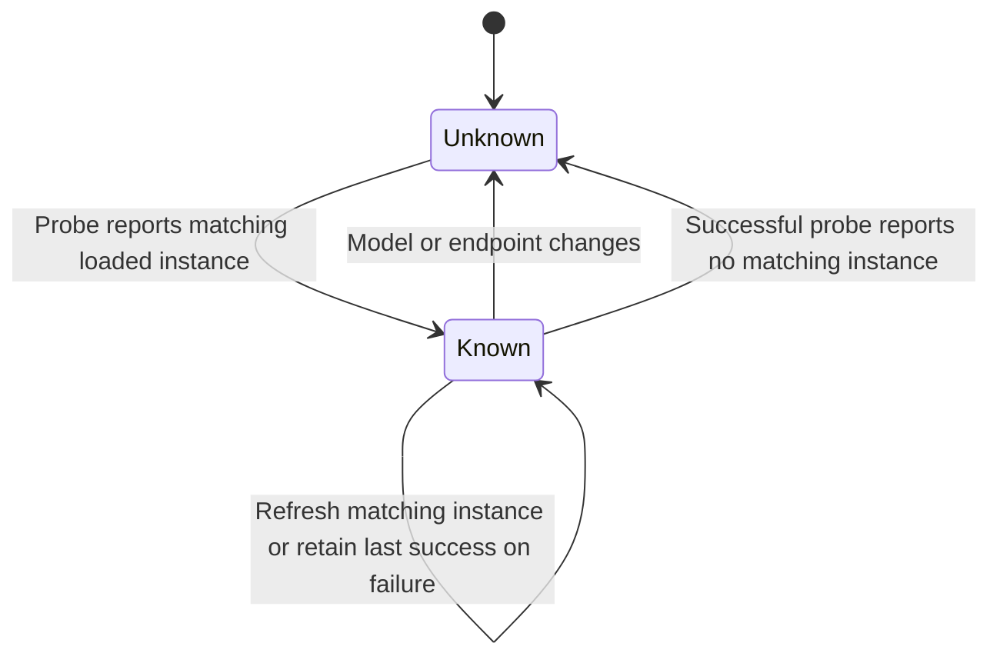

# TASK-8d44c865 diagrams

Illustrates the Design in TASK-8d44c865.md.

## Structure

Changed: AISettingsPage, ai_backend_service, ai_budget_service, llm_provider_service. Reused: provider and workflows as facade consumers.

## Sequence

## State

