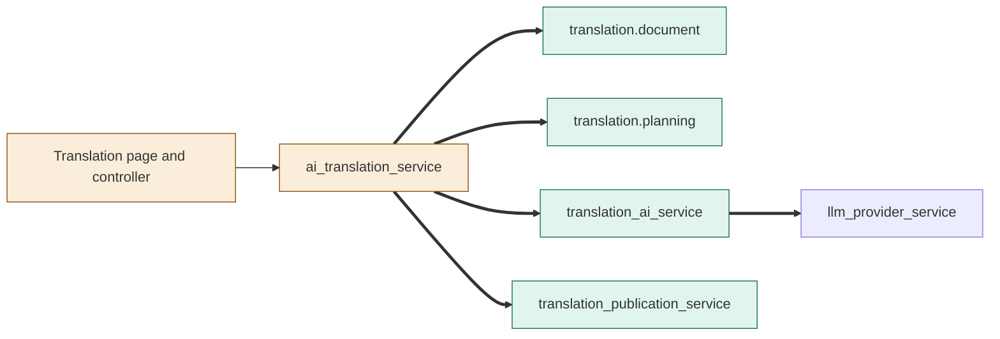
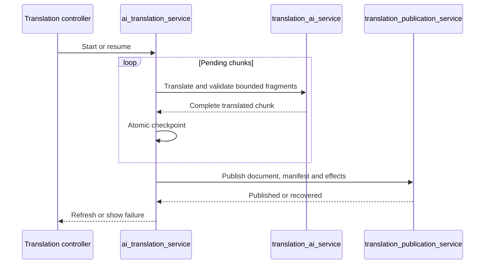
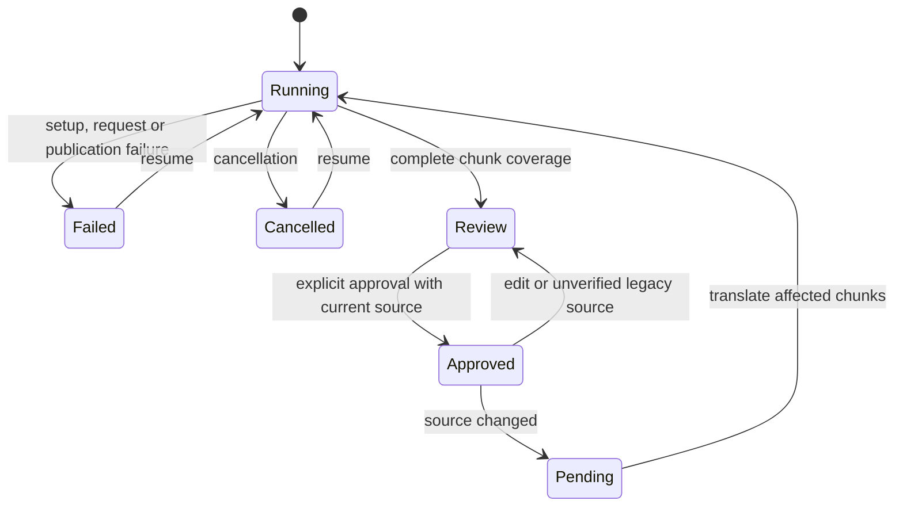

# TASK-a3c94d07 diagrams
Illustrates the journal Design.

## Structure
Map: UI and orchestrator changed; document, planner, adapter, and publication added; provider unchanged.

## Sequence

## State

