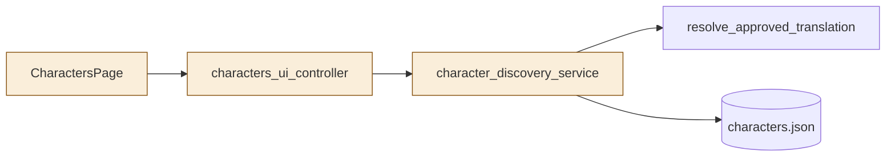
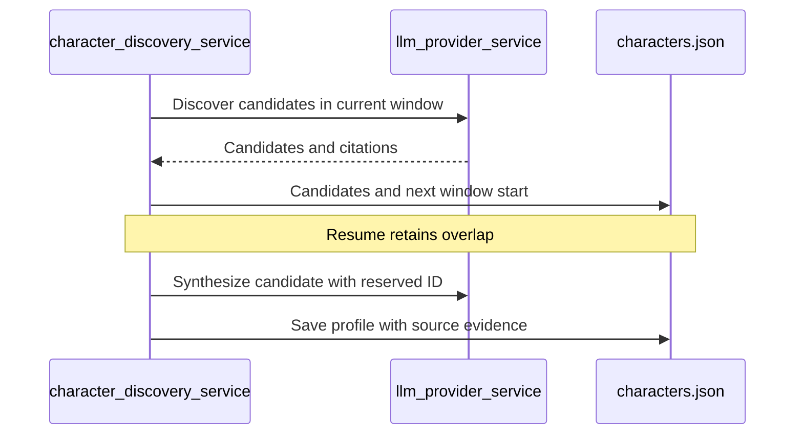

# TASK-a68ffabe diagrams

The task journal's design is authoritative.

## Structure

Changed: CharactersPage, characters_ui_controller, character_discovery_service.
Reused: approved translation resolver, characters.json.

## Sequence

## State

```mermaid
stateDiagram-v2
    [*] --> Discovery
    Discovery --> Interrupted: Cancel or provider error
    Interrupted --> Discovery: Resume at next planned window
    Discovery --> Synthesis: Last window checkpointed
    Synthesis --> Review: Profiles saved
    Review --> Draft: Edit Character
    Draft --> Review: Save or discard
```

