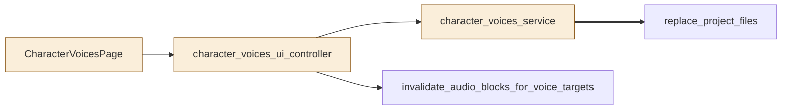
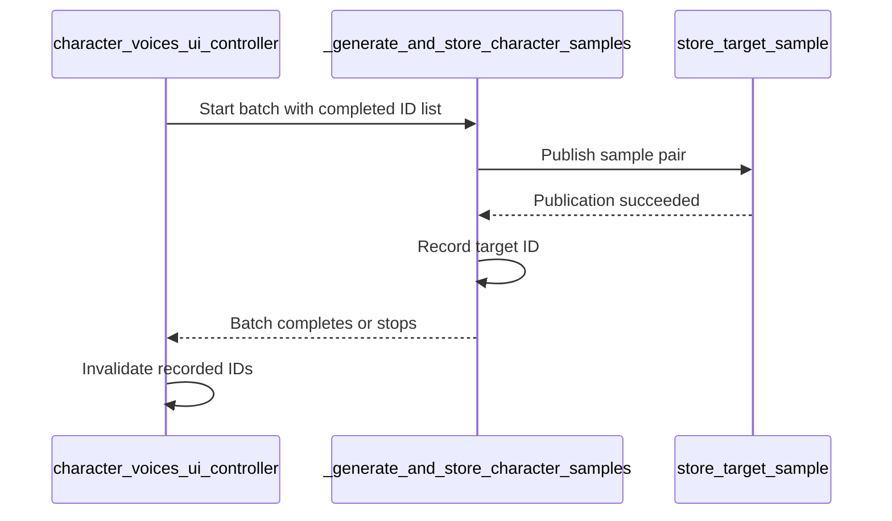
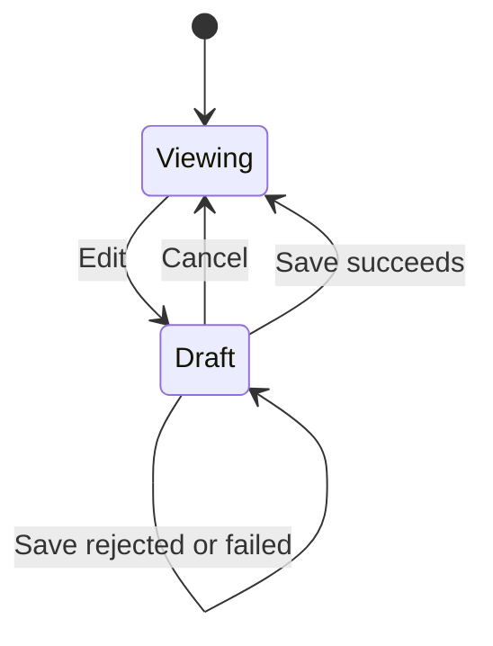

# TASK-b87d0a4d diagrams

Illustrates the Design in TASK-b87d0a4d.md.

## Structure

Changed: CharacterVoicesPage, character_voices_ui_controller, character_voices_service.
Reused: replace_project_files, invalidate_audio_blocks_for_voice_targets.

## Sequence

## State

