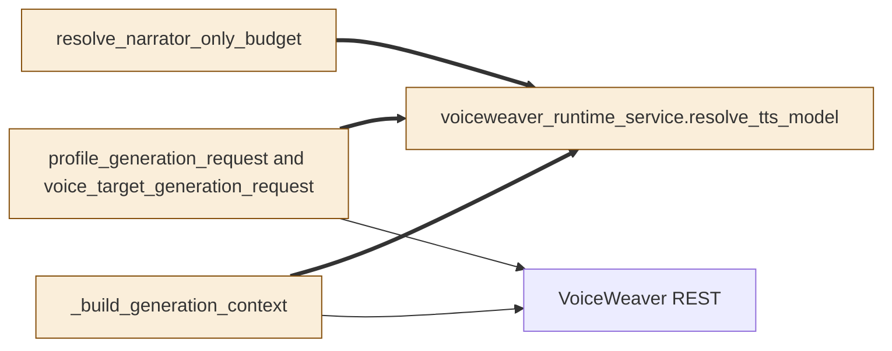
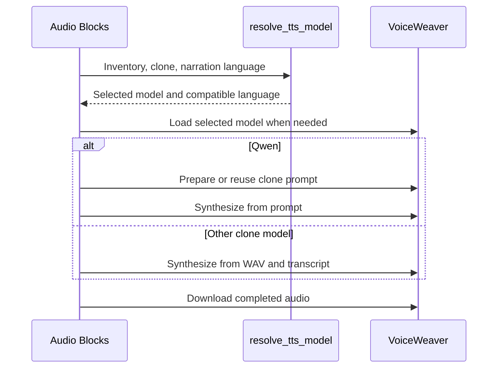

# TASK-c20ea841 diagrams

Illustrates the design in TASK-c20ea841.md.

## Structure

Changed nodes: voice previews, Speech Blocks budget, Audio Blocks and runtime selection.
Reused node: VoiceWeaver REST.

## Sequence

## State

Not drawn: model selection leaves the operation lifecycle and persisted states as they are.
