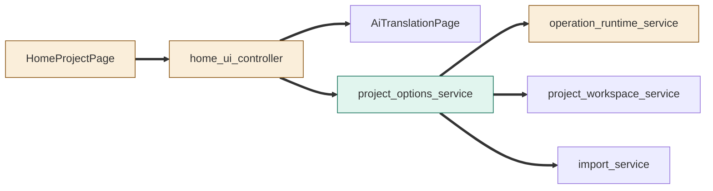
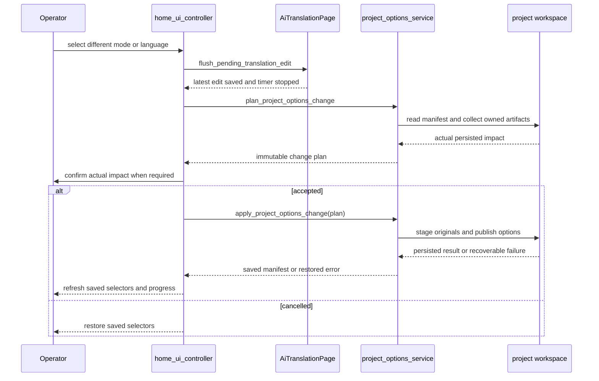
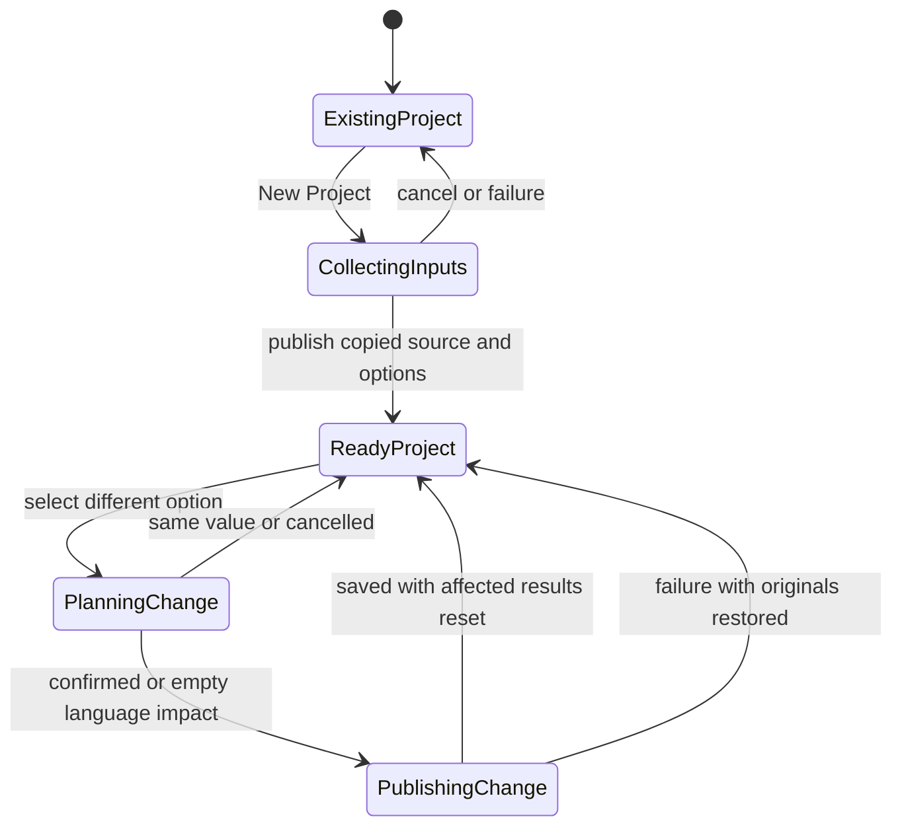

# TASK-f46ffa1a diagrams

Illustrates `## Design` in `TASK-f46ffa1a.md`. The Design text is authoritative.

Node classification: HomeProjectPage, home_ui_controller and operation_runtime_service = changed; project_options_service = added; project_workspace_service, import_service and AiTranslationPage = reused unchanged. MainWindow wiring is changed but omitted for clarity.

## Structure

## Sequence

## State

