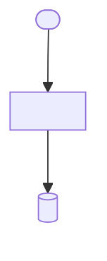

<!--
Copyright (c) 2026 DDP Engineering
This software is licensed under the PolyForm Noncommercial License 1.0.0.
Commercial use requires a separate commercial license.
See the LICENSE.txt in the .agentic folder for full license details.
SPDX-License-Identifier: LicenseRef-PolyForm-Noncommercial-1.0.0
-->

<!--
Component knowledge page, at .agentic/knowledge/<component>.md, one per
component. This is what a session loads instead of re-reading the whole
component's source, so keep it short, current, and true. Updated at
validate whenever the component's behavior, interface, or file set changed.
Sections below are recommended, not mandatory.
-->

# <component name>

## Purpose

Two or three sentences: what this component is responsible for, and what
it deliberately is not responsible for.

## Public interface

How the rest of the system uses it — entry points, exported functions or
classes, commands, input and output formats. Not the internals.

## Key behaviors

- `REQ-FUNC-0000` — one line describing the behavior.
- One line per behavior that has no requirement yet, marked `(no req)`.

## Architecture

How this component works inside, as a Mermaid diagram. Scope it to this
component: the parts a reader has to hold in their head to change it
safely, and the boundaries where it meets everything else. Not the whole
system, and not every function — if it does not change how someone would
edit this code, leave it out. Ten to fifteen nodes is usually the honest
size; past twenty, the component is probably two.

Arrows carry direction, so only draw one where you can say which way it
points: calls, data flow, ownership. Name each node after the thing in the
code, so a reader can search for it, and mark the boundary nodes — entry
points, storage, anything outside this component — differently from the
internals.

One or two sentences under the diagram for what it does not show, or for
the constraint that explains an odd shape. Keep this drawn as the code is
now. A task records a proposed shape in its design, then updates this current
diagram at validate after the implementation matches.

## Files

- `src/<component>/<file>.py` — one line on its role.

Keep this list complete: it is how a reader finds the code, and stale
entries are the first sign the page has drifted.
