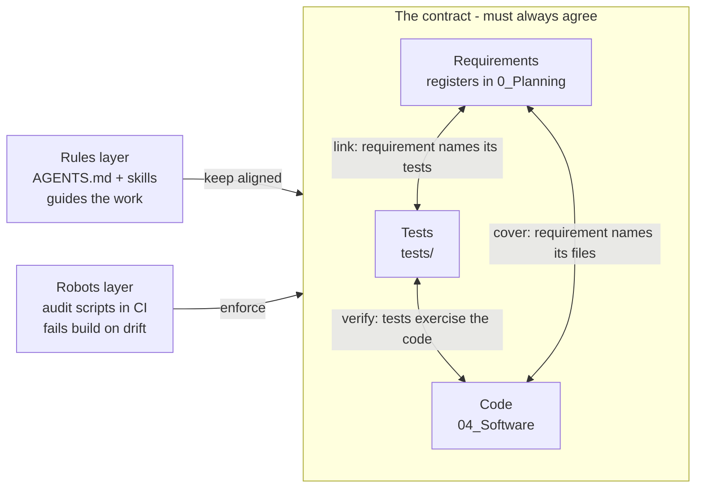
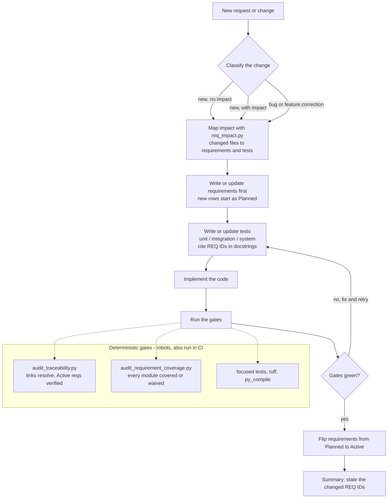

<!--
Copyright (c) 2026 DDP Engineering
This software is licensed under the GNU Affero General Public License v3.0
(AGPL-3.0) with additional Non-Commercial restriction.
See the LICENSE.txt and LICENSE_NC.txt files for full license details.
-->

# Requirements-Driven Development Workflow

This document explains, in plain language, how AudioMancer keeps requirements,
tests, and code in agreement, and how the same approach can be reused in other
repositories that use a different language or environment.

## 1. The Core Idea

The workflow treats three things as one contract that must always agree:

- **Requirements** - plain statements of what the application must do, stored as
  Markdown tables under `.agentic/requirements/` (the registers).
- **Tests** - the automated checks that prove each requirement is true.
- **Code** - the implementation under `04_Software/AudioMancer/`.

The registers are the glue. Every requirement row names the code files it covers
and the exact tests that guard it. A requirement is therefore never just a wish;
it points at the test that keeps it honest.

The main risk in any system like this is drift: someone renames a test, deletes
one, or adds a new module with no test, and the paperwork silently goes stale.
Everything below exists to make drift impossible to ignore.

## 2. Two Layers: Rules And Robots

The workflow has a guidance layer for whoever does the work, and an enforcement
layer that does not depend on anyone remembering anything.

The diagram below shows the contract the workflow protects: requirements,
tests, and code must stay in agreement. The rules layer guides a person or
agent to keep them aligned, and the robots layer fails the build when they
drift apart.

### Rules (guidance for the human or AI)

These live in `AGENTS.md` and in the skills under `.claude/skills/` and
`.codex/skills/` (`feature-intake` and `requirements-traceability`). They state
the order of work: classify the change, check what it impacts, write or update
the requirement first, then the tests, then the code. A person or an agent
follows these.

### Robots (deterministic scripts that cannot be argued with)

These are the audit tools under `02_Tools/audits/`. They enforce the contract
mechanically:

- `audit_traceability.py` reads every register, discovers every real test in the
  suite, and reports if a requirement points at a test that no longer exists, or
  if an Active requirement has no automated test and no manual method.
  Implements `REQ-TEST-006`.
- `audit_requirement_coverage.py` checks that every code module under
  `services/` and `ui/controllers/` is covered by a test-linked requirement, or
  is listed in the waiver file. Implements `REQ-TEST-007`.
- `req_impact.py` answers "if I change these files, which requirements and tests
  does that touch?" This makes the check-impact-first rule practical.
- `requirements_lib.py` is the shared parser for the register tables and the
  static test discovery used by the tools above.

The audits also run as ordinary tests through
`04_Software/AudioMancer/tests/test_traceability.py`, and are intended to run in
CI. A change that breaks the contract fails the build. This is the key point:
rules can be forgotten, but the gate cannot.

## 3. Supporting Files

- `.agentic/requirements/*.md` - the requirement registers, one file per type.
- `.agentic/requirements/coverage_waivers.txt` - the recorded list of
  pre-existing coverage gaps. It lets the coverage gate pass today while still
  blocking new untested modules. Each entry is a debt to retire: add a
  requirement and a test for the module, then delete its line. The audit reports
  a stale waiver once a waived module becomes covered, so the list cannot rot.
- `feature-intake` skill - the intake step that classifies a change and produces
  a short Change Plan before any code is written.
- `requirements-traceability` skill - the rules for adding and updating register
  rows.

## 4. The Lifecycle, Start To Finish

The diagram below shows the requirements-first loop. The work steps run in order,
and the deterministic gates (the robots) must pass before a requirement becomes
`Active` and before a change can land.

1. A new request arrives. Classify it: brand-new feature with no impact on
   existing files, new feature that changes existing files, or a bug or feature
   correction.
2. Run `req_impact.py` to see which requirements and tests the change touches.
3. Write or update the requirement rows first. New rows start as `Planned`.
4. Write or update the tests at the right level, and cite the requirement IDs in
   the test docstrings.
5. Implement the code.
6. Run the focused checks and the audit gates. A requirement flips from
   `Planned` to `Active` once a real linked test exists and passes.
7. State, in the final summary, which requirement IDs changed and what was
   validated.

The three change classes map to clear outcomes:

| Change class | Requirements | Tests |
| --- | --- | --- |
| New feature, no impact | add new | add new |
| New feature, with impact | add new and update impacted | add new and update impacted |
| Bug or feature correction | update existing, add only if a gap is found | update existing, add only if a gap is found |

## 5. Reusing This In Other Repositories And Languages

The method is fully portable. Only a few small pieces are specific to Python and
pytest.

### What carries over unchanged to any repository or language

- The Markdown registers and their table schema. They are just text.
- The waiver-baseline pattern for recording and retiring known gaps.
- The `feature-intake` skill and the requirements-first lifecycle.
- The `AGENTS.md` policy and the approach of enforcing gates in CI.
- The logic of `req_impact.py`, which only matches changed file paths against the
  paths named in requirements.

### What must be adapted per ecosystem

Three things depend on how the target language defines and discovers tests:

| Concern | Python (current) | JavaScript | Go | Java |
| --- | --- | --- | --- | --- |
| Test discovery | `ast` finds `def test_*` | parse `describe`/`it` or `jest --listTests` | `go test -list` or find `func Test*` | find `@Test` methods |
| Test address in the register | `tests/file.py::test_name` | `file.test.js > suite > case` | `package.TestName` | `Class#method` |
| Module roots and file extension | `services/`, `ui/controllers/`, `.py` | `src/`, `.ts` | packages, `.go` | `src/main`, `.java` |

The clean way to make this reusable is to move those three concerns into a small
configuration file (which folders count as coverable code, the test file
extension, and the command that lists tests) and to write one small test-collector
adapter for the language. The registers, the gates, the intake flow, and the CI
wiring stay the same.

One practical note: the audit scripts are written in Python but only read
Markdown and source files. A non-Python repository can keep them as a standalone
Python tool if Python is available on the CI runner, instead of rewriting them.
A language-specific test-discovery adapter is still required either way.

In short, the shape of the solution is universal. Only the part that knows what a
test looks like in a given language needs a local translation.

## 6. Related Requirements

- `REQ-TEST-006` - linked test nodes resolve and Active requirements
  declare a verification method.
- `REQ-TEST-007` - every service and controller module is covered by a
  test-linked requirement or a recorded waiver.
- `REQ-TEST-008` - a clean full test run gates any release.
- `REQ-TEST-009` - the documentation audit gates any release.
- `REQ-TEST-010` - a deterministic end-to-end pipeline smoke test (planned).
