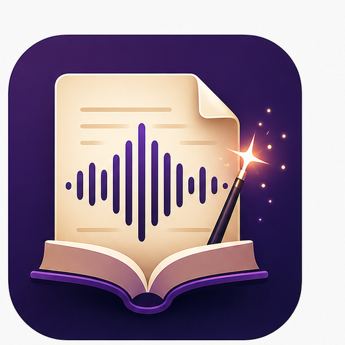

<!--
Copyright (c) 2026 DDP Engineering
This software is licensed under the GNU Affero General Public License v3.0
(AGPL-3.0) with additional Non-Commercial restriction.
See the LICENSE.txt and LICENSE_NC.txt files for full license details.
-->
# AudioMancer

<p align="center">
  
</p>

<p align="center">
  <strong>Transform written words into real audio experience!</strong>
</p>

AudioMancer is a Windows desktop application for preparing translated books and
audiobook production assets. It combines operator-controlled text processing,
optional AI-assisted workflow steps, voice preparation, speech block review,
audio block generation, and final WAV assembly.

This repository contains the private source tree, planning material,
implementation documentation, tooling, delivery scripts, and support files for
AudioMancer.

## Current Implementation

`04_Software/AudioMancer/` contains the Python 3.12/PySide6 desktop
application.

AudioMancer supports a reviewed audiobook-preparation workflow that includes:

- project creation and source import
- text cleanup and text chunking
- AI translation
- character discovery
- narrator and character voice preparation
- speech block editing and approval, including optional Scene Ambience sound
  cues as individual ordered blocks
- audio block generation for spoken text and approved Scene Ambience prompts
- WAV audio assembly with optional mixed Scene Ambience inclusion and preview
- text, project, voice-sample, and audio-output exports

The application is designed so operators can combine AI-assisted steps with
manual review and manual editing. The workflow pages preserve completed work
where possible and reset only affected downstream artifacts when source text,
chunks, voices, speech blocks, audio blocks, or assembly settings change.
Runtime diagnostics for generation workflows are written through the shared
logging service so VoiceWeaver calls, Scene Ambience generation, and long
operation checkpoints can be reviewed after a run.
Long text-chunking runs keep resumable checkpoints and atomic project artifacts
without changing the completed chunk output.
Text cleanup now follows the same safety-first persistence model: deterministic
and AI cleanup writes critical artifacts atomically, tolerates malformed
operation state by restarting cleanly, and records terminal failed/cancelled
states with resumable checkpoints where possible.
AI Translation uses atomic translated-artifact persistence, read-only
steady-state page synchronization, and terminal cancel/failure state records to
protect completed LLM output during interrupted runs.
Narrator voice preparation uses atomic narrator metadata/sample persistence,
cooperative VoiceWeaver cancellation, and terminal failed/cancelled checkpoints
so interrupted runs preserve prior usable samples and resumable AI analysis.
Character Voices uses matching atomic target/sample persistence, cooperative
VoiceWeaver cancellation, non-destructive failed generation, and read-only
unchanged same-narrator refreshes while preserving full-current-target batch
regeneration.

## Repository Layout

- `0_Planning/` - planning notes and design drafts.
- `01_Documentation/` - project-level documentation and media.
- `02_Tools/` - packaging, audit, and repository utility scripts.
- `04_Software/` - application source code.
- `05_SoftwareDocu/` - implementation documentation and offline user help.
- `07_Delivery/` - delivery metadata and release packaging notes.
- `09_Others/` - runtime projects, samples, and local support material.

## Documentation

- `04_Software/AudioMancer/README.MD` contains application development,
  runtime, and validation notes.
- `05_SoftwareDocu/` contains focused implementation documentation.
- `05_SoftwareDocu/UserGuide/` contains the English offline help bundle.
- `05_SoftwareDocu/UserGuide_ro/` contains the Romanian offline help bundle.
- `CHANGELOG.md` contains detailed version history.
- Current release metadata is maintained in the application package metadata
  and package `__version__`; README files intentionally avoid embedding the
  current application version.
- `HowToTest.md` summarizes the broader validation baseline.

## Development

The application code lives under `04_Software/AudioMancer/` and is managed as a
Python project. Use the application README in that folder for setup, test, and
runtime details.

For Python changes in the application subtree, run targeted validation from
`04_Software/AudioMancer/`, preferably through `uv`:

```powershell
uv run ruff check <changed_python_files> --fix
uv run ruff format <changed_python_files>
uv run python -m py_compile <changed_file.py>
```

## Release Notes

Use `CHANGELOG.md` for source-level version history. Generated delivery
archives are not committed to this repository; Windows release packages are
published through the configured GitHub Releases delivery flow.

## License

AudioMancer is licensed under the GNU Affero General Public License v3.0
(AGPL-3.0) with an additional Non-Commercial restriction. See `LICENSE.txt` and
`LICENSE_NC.txt` for full license details.
